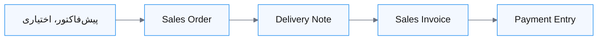
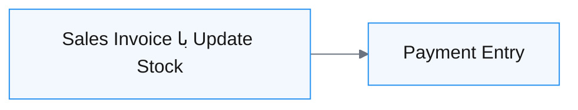
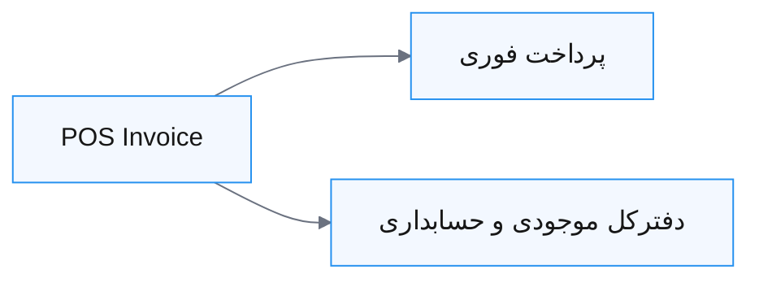
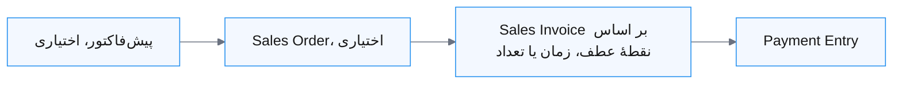
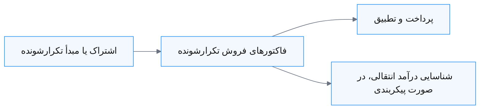
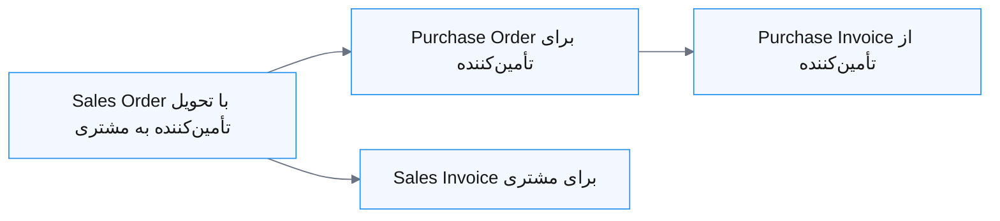
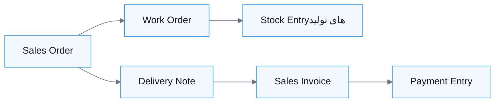
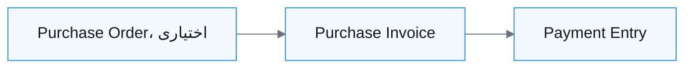
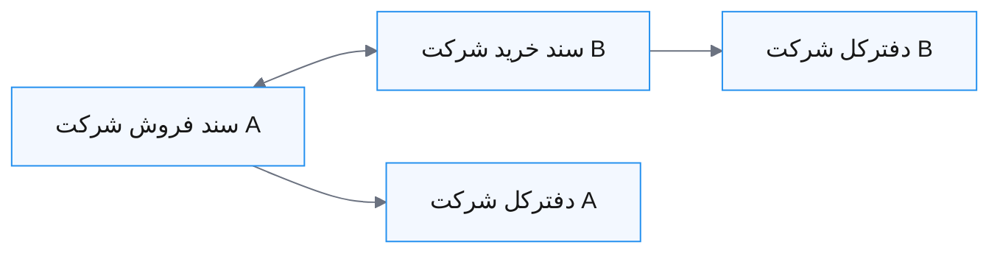

دو شرکت ممکن است درآمد یکسانی داشته باشند، اما به گردش‌کارهای حسابداری کاملاً متفاوتی نیاز پیدا کنند. کسب‌وکار محصول‌محور باید گردش و بهای موجودی را پیگیری کند؛ کسب‌وکار خدماتی ممکن است بر اساس زمان یا نقاط عطف فاکتور صادر کند؛ و کسب‌وکار اشتراکی ممکن است پیش از کسب درآمد، وجه نقد دریافت کند.

Nova Industries لوازم الکترونیکی تولید و توزیع می‌کند؛ بنابراین یک فروش معمولی می‌تواند بر دریافتنی‌ها، درآمد، موجودی و Cost of Goods Sold اثر بگذارد. در مقابل، تیم نصب آن می‌تواند برای یک خدمت بدون Delivery Note یا ثبت موجودی فاکتور صادر کند. ERPNext از هر دو جریان پشتیبانی می‌کند، اما سندها و تنظیمات باید با رویداد اقتصادی مطابقت داشته باشند.

این صفحه کمک می‌کند گردش‌کار مناسب فروش، خرید، موجودی، درآمد انتقالی و پرداخت را برای مدل کسب‌وکارتان انتخاب کنید. همچنین نشان می‌دهد کدام سندها اختیاری‌اند و کدام‌یک ثبت دفترکل یا موجودی ایجاد می‌کنند.

## انتخاب نقاط عطف موردنیاز

پیش از انتخاب گردش‌کار، به این پرسش‌ها پاسخ دهید:

1. آیا پیش از صدور فاکتور باید تعهد مشتری یا تأمین‌کننده ثبت شود؟
2. آیا موجودی فیزیکی جابه‌جا می‌شود؟
3. آیا عملیات باید تحویل یا دریافت را جدا از واحد مالی تأیید کند؟
4. صورتحساب بر اساس تعداد، زمان، نقاط عطف، میزان استفاده یا برنامهٔ تکرارشونده صادر می‌شود؟
5. پرداخت فوری، پیشاپیش یا اعتباری است؟
6. کالا از Warehouse شما می‌گذرد، مستقیماً میان طرف‌ها جابه‌جا می‌شود یا اصلاً به‌عنوان موجودی نگهداری نمی‌شود؟

انواع سند زیر نقاط عطف متفاوتی را نشان می‌دهند:

| سند | نقطهٔ عطف | اثر بر General Ledger |
|---|---|---|
| Quotation | پیشنهاد تجاری | ندارد |
| Sales Order یا Purchase Order | تعهد تأییدشده | ندارد |
| Delivery Note یا Purchase Receipt | انجام فیزیکی | با موجودی دائمی، ثبت موجودی دارد |
| Sales Invoice یا Purchase Invoice | صورتحساب و مبلغ قابل‌پرداخت | دارد |
| Payment Entry | جابه‌جایی و تخصیص وجه | دارد |

## فروش استاندارد کالا

**مناسب برای:** عمده‌فروشی، توزیع، فروش تجهیزات و کسب‌وکارهایی که فروش، انبار، صدور فاکتور و وصول در زمان‌های متفاوت انجام می‌شوند.

**مزایا:** هر تیم نقطهٔ عطف خود را تأیید می‌کند؛ پیگیری تحویل و صورتحساب جزئی آسان است؛ Sales Order درصدهای تحویل و صدور فاکتور را نشان می‌دهد؛ موجودی و دریافتنی‌ها در مرحلهٔ درست ثبت می‌شوند.

**ملاحظات:** سندهای بیشتری باید تکمیل و تطبیق داده شوند. کاربران باید سندهای پایین‌دستی را از سفارش یا تحویل بسازند تا زنجیرهٔ انجام کار پیوندخورده بماند.

**پیکربندی:** Itemهای دارای موجودی و Warehouseها را نگه دارید؛ اگر حرکت موجودی باید در General Ledger ثبت شود، موجودی دائمی را فعال کنید؛ پیش‌فرض‌های درآمد و هزینهٔ Item و حساب‌های دریافتنی، مالیات و بهای تمام‌شدهٔ کالای فروش‌رفته را تنظیم کنید.

Sales Order یک تعهد است و معمولاً در دفترکل ثبت نمی‌شود. [Delivery Note](https://docs.frappe.io/erpnext/delivery-note) موجودی را کاهش و بها را شناسایی می‌کند. [Sales Invoice](https://docs.frappe.io/erpnext/sales-invoice) درآمد، مالیات و دریافتنی را ثبت می‌کند. پرداخت، مبلغ تسویه‌نشده را پاک می‌کند.

برای تأمین دوبارهٔ موجودی، چرخهٔ جداگانهٔ Purchase Order، Purchase Receipt، Purchase Invoice و پرداخت را دنبال کنید.

## فاکتور مستقیم با به‌روزرسانی موجودی

**مناسب برای:** فروشگاه‌های کوچک، فروش سادهٔ پیشخوانی و کسب‌وکارهای کم‌پیچیدگی که تحویل و صدور فاکتور را هم‌زمان انجام می‌دهند، اما به گردش‌کار کامل POS نیاز ندارند.

**مزایا:** یک سند درآمد، دریافتنی، کاهش موجودی و بهای تمام‌شدهٔ کالای فروش‌رفته را ثبت می‌کند. نیازی به تکمیل Delivery Note جداگانه نیست.

**ملاحظات:** انبار و واحد مالی نقطهٔ تأیید جداگانه ندارند. اگر کنترل مستقل برداشت، ارسال، اثبات تحویل یا انجام جزئی لازم است، این روش مناسب نیست.

**پیکربندی:** Itemهای موجودی و Warehouseها را نگه دارید، موجودی دائمی و حساب‌های Item را تنظیم و سپس **Update Stock** را در Sales Invoice فعال کنید. اگر پرداخت فوری است، آن را با Payment Entry یا فیلدهای پرداخت پشتیبانی‌شده در گردش‌کار صورتحساب انتخاب‌شده ثبت کنید.

فاکتور بر General Ledger و Stock Ledger هر دو اثر می‌گذارد. Sales Order جداگانه همچنان اختیاری است. اگر فاکتور را مستقیم بسازید، سفارشی وجود ندارد که بتوان درصد تحویل یا صورتحساب آن را پیگیری کرد. مسیر ترکیبی را در [Sales Invoice با Update Stock](https://docs.frappe.io/erpnext/sales-invoice#update-stock) ببینید.

## فروش خرده‌فروشی و نقطهٔ فروش

**مناسب برای:** فروشگاه‌ها و پیشخوان‌هایی که مشتری کالا را دریافت و در همان تعامل پرداخت می‌کند.

**مزایا:** انتخاب Item، قیمت‌گذاری، مالیات، به‌روزرسانی موجودی، صدور فاکتور و پرداخت در یک رابط مناسب صندوق ترکیب می‌شوند. POS Closing فعالیت شیفت را تجمیع و تطبیق می‌دهد.

**ملاحظات:** این روش برای چرخه‌های طولانی انجام سفارش، صورتحساب پروژه‌ایِ توافقی یا کنترل اعتباری پیچیده طراحی نشده است. برگشت کالا و بستن شیفت به رویه‌های یکسان صندوق‌داران نیاز دارد.

**پیکربندی:** [POS Profile](https://docs.frappe.io/erpnext/point-of-sale) بسازید و Company، Warehouse، فهرست قیمت، روش‌های پرداخت، مالیات‌ها و کاربران مربوط را انتخاب کنید. رویه‌های آغاز و پایان شیفت و مسئولیت اختلاف وجه نقد را مشخص کنید.

## فروش خدماتی یا پروژه‌محور

**مناسب برای:** مشاوره، آژانس‌ها، شرکای پیاده‌سازی، ارائه‌دهندگان نگه‌داری و کسب‌وکارهای پروژه‌ای که کالای موجودی‌دار تحویل نمی‌دهند.

**مزایا:** از سندهای موجودیِ غیرضروری جلوگیری می‌کند. Sales Order می‌تواند دامنهٔ تجاری را ثبت و پیشرفت صورتحساب را پیگیری کند. Project، Task و Timesheet تلاش و هزینهٔ انجام کار را گردآوری می‌کنند.

**ملاحظات:** پیشرفت به ثبت منظم نقاط عطف، زمان یا تعداد وابسته است. Sales Invoice صدور صورتحساب را ثابت می‌کند، نه تأیید انجام کار را؛ مگر آن‌که فرایند شما تأیید را جداگانه ثبت کند.

**پیکربندی:** Itemهای خدماتیِ فاقد موجودی، حساب‌های درآمد و هزینه، Payment Terms و در صورت نیاز به سودآوری، Projectها را بسازید. اگر فاکتورها بر ساعت‌های تأییدشده مبتنی‌اند، از [صورتحساب مبتنی بر Timesheet](https://docs.frappe.io/erpnext/sales-invoice#timesheet) استفاده کنید.

برای صورتحساب بر اساس نقاط عطف، یک Item خدماتی با تعدادی مانند `1.000` به‌کار ببرید. در سه فاکتور به‌ترتیب `0.250`، `0.500` و `0.250` را صورتحساب کنید تا 25٪، 50٪ و 25٪ قرارداد نشان داده شود. نرخ را برابر ارزش کامل قرارداد نگه دارید. ERPNext با مقدارهای اعشاری، سهم صورتحساب‌شدهٔ Sales Order را پیگیری می‌کند.

برای خدمت فاقد موجودی معمولاً Delivery Note لازم نیست. ساخت مستقیم Sales Invoice معتبر است، اما اگر به سفارشی پیوند نداشته باشد، پیشرفت صورتحساب Sales Order را به‌روز نمی‌کند.

## خدمت تکرارشونده یا اشتراک

**مناسب برای:** اشتراک نرم‌افزار، قراردادهای حق‌الزحمهٔ ثابت، عضویت، طرح‌های پشتیبانی، اجاره و دیگر خدمات دوره‌ای.

**مزایا:** ایجاد منظم فاکتور را خودکار می‌کند و می‌تواند صدور فاکتور را از شناسایی درآمد جدا سازد. Payment Terms، یادآوری‌ها و گزارش‌های دریافتنی به وصول کمک می‌کنند.

**ملاحظات:** تاریخ طرح، لغو، ارتقا، محاسبهٔ سهمی، پرداخت ناموفق و تغییر مالیات به قواعد اجرایی روشن نیاز دارند. ایجاد خودکار فاکتور، وصول وجه را تضمین نمی‌کند.

**پیکربندی:** [Subscriptions](https://docs.frappe.io/erpnext/subscription)، طرح‌ها، پیش‌فرض‌های Customer، مالیات‌ها، سررسیدها و پردازش تکرارشونده را تنظیم کنید. اگر درآمد باید طی دورهٔ خدمت شناسایی شود، نه یکجا در تاریخ فاکتور، [درآمد انتقالی](https://docs.frappe.io/erpnext/deferred-revenue) را پیکربندی کنید.

## فروش با ارسال مستقیم از تأمین‌کننده

**مناسب برای:** توزیع‌کنندگان و فروشگاه‌های آنلاین که تأمین‌کننده کالا را مستقیم برای مشتری می‌فرستد.

**مزایا:** از دریافت و ارسال کالا از Warehouse شما جلوگیری می‌کند. سندهای فروش و خرید پیوند دارند و ردگیری حاشیهٔ سود و انجام سفارش تأمین‌کننده آسان‌تر می‌شود.

**ملاحظات:** کنترل فیزیکی شما بر موجودی، بسته‌بندی، زمان تحویل و مدرک تحویل کمتر است. نشانی و ارتباط با تأمین‌کننده و مشتری باید دقیق باشد. دفترکل معمول موجودی Warehouse این کالاها را نشان نمی‌دهد، چون شرکت شما آن‌ها را دریافت نمی‌کند.

**پیکربندی:** Itemهای مربوط را طوری علامت بزنید که از سوی تأمین‌کننده تأمین می‌شوند؛ در صورت نیاز تأمین‌کنندهٔ پیش‌فرض را تنظیم کنید؛ در ردیف Item در Sales Order گزینهٔ **Supplier delivers to Customer** را انتخاب و Purchase Order را از همان Sales Order بسازید. گردش‌کار [Drop Ship](/erpnext/drop-ship) را دنبال کنید تا سندها پیوندخورده بمانند.

Sales Invoice درآمد و دریافتنی مشتری را ثبت می‌کند. Purchase Invoice بهای تأمین‌کننده و پرداختنی را ثبت می‌کند. Sales Order و Purchase Order تعهدند و در دفترکل ثبت نمی‌شوند.

## تولید بر مبنای سفارش

**مناسب برای:** تولیدکنندگانی که کالای نهایی را بر اساس تقاضای تأییدشده می‌سازند.

**مزایا:** تقاضا، برنامه‌ریزی مواد، تولید، موجودی کالای نهایی، تحویل، صورتحساب و سودآوری را به هم پیوند می‌دهد. Stock Entryهای تولید، ارزش اجزا را به Item نهایی منتقل می‌کنند.

**ملاحظات:** Bills of Materials، Warehouseها، Work Orderها، ارزش‌گذاری، ضایعات و رویه‌های کالای در جریان ساخت باید دقیق نگه داشته شوند. ثبت‌های موجودی با تاریخ گذشته می‌توانند باعث ثبت دوبارهٔ ارزش‌گذاری شوند.

**پیکربندی:** Itemهای موجودی، Warehouseها، Bills of Materials، Workstationها، عملیات و پیش‌فرض‌های تولید را تنظیم کنید. در صورت نیاز از [درخواست مواد اولیه از Sales Order](https://docs.frappe.io/erpnext/request-for-raw-materials-from-sales-order) یا برنامه‌ریزی تولید استفاده کنید.

Sales Order تقاضا ایجاد می‌کند، اما ثبت حسابداری ندارد. Stock Entryهای تولید بر ارزش موجودی اثر می‌گذارند. Delivery بهای تمام‌شدهٔ کالای فروش‌رفته را ثبت می‌کند و فاکتور درآمد و دریافتنی را.

## گردش‌کار خدمات و هزینه با محوریت خرید

**مناسب برای:** خدمات حرفه‌ای، اجاره، آب‌وبرق، نرم‌افزار و خریدهای دیگری که دریافت فیزیکی به انبار ندارند.

**مزایا:** از Purchase Receiptای که ارزش عملیاتی ندارد جلوگیری می‌کند. Purchase Order همچنان می‌تواند پیش از رسیدن فاکتور تأمین‌کننده، کنترل بودجه یا تأیید را فراهم کند.

**ملاحظات:** تأیید جداگانه‌ای برای دریافت کالا وجود ندارد. تیم به روش دیگری نیاز دارد تا پیش از تأیید فاکتور، پذیرش خدمت را بررسی کند.

**پیکربندی:** Itemهای فاقد موجودی یا حساب‌های هزینهٔ مناسب، Payment Terms تأمین‌کننده، مالیات‌ها، Cost Centerها، Projectها و گردش‌کارهای تأیید را به‌کار ببرید. [Purchase Invoice](https://docs.frappe.io/erpnext/purchase-invoice) ارزش هزینه یا دارایی و پرداختنی به تأمین‌کننده را ثبت می‌کند.

## گردش‌کار چندشرکتی و بین‌شرکتی

**مناسب برای:** گروه‌هایی با شخصیت‌های حقوقی جداگانه که با یکدیگر معامله می‌کنند.

**مزایا:** هر شخصیت حقوقی رد حسابرسی مستقل و متوازن خود را نگه می‌دارد و سندهای پیوندخورده ورود تکراری اطلاعات را کاهش می‌دهند. صورت‌های مالی تلفیقی نمای گروهی ارائه می‌کنند.

**ملاحظات:** Companyها، Customer و Supplierهای داخلی، قیمت‌ها، مالیات‌ها، ارزها و حساب‌های بدهکار/بستانکار بین‌شرکتی باید هم‌راستا باشند. تلفیق جایگزین حذف‌های تلفیقی یا فرایند قانونی موردنیاز سیاست حسابداری شما نیست.

**پیکربندی:** طرف‌های مربوط را داخلی علامت‌گذاری و به Companyها نگاشت کنید، حساب‌های بین‌شرکتی را تنظیم و از [Inter Company Invoices](https://docs.frappe.io/erpnext/inter-company-invoices) یا Journal Entryهای بین‌شرکتی استفاده کنید. پیش از به‌کارگیری خودکارسازی در محیط عملیاتی، هر دو سمت را آزمایش کنید.

## تصمیم‌گیری دربارهٔ سندهای اختیاری

فقط نپرسید آیا ERPNext اجازه می‌دهد سندی را رد کنید؛ بررسی کنید با حذف آن چه کنترلی از دست می‌رود.

| اگر این سند را حذف کنید | دیگر چه چیزی نخواهید داشت |
|---|---|
| Quotation | پیشنهاد نسخه‌بندی‌شده پیش از تعهد مشتری |
| Sales Order | سابقهٔ مرکزی مقدار تعهدشده و پیشرفت تحویل و صورتحساب |
| Delivery Note | تأیید جداگانهٔ انبار و مدرک تحویل موجودی |
| Purchase Order | تعهد و مجوز پیش از خرید و پیگیری مقدار سفارش‌داده‌شده در برابر فاکتور |
| Purchase Receipt | تأیید جداگانهٔ دریافت و ذخیرهٔ تعهد کالای دریافت‌شده اما فاکتورنشده |

برای گردش‌کار کوتاه، ساخت مستقیم سند پایین‌دستی ممکن است درست باشد؛ اما سند بالادستیِ حذف‌شده یا بدون پیوند را به‌روز نمی‌کند. اگر سفارشی وجود دارد، Delivery، Receipt یا Invoice را از همان سفارش بسازید تا ERPNext درصدها و وضعیت مرتبط را به‌روز کند.

## پیشنهاد برای پیاده‌سازی

برای هر خط کسب‌وکار با یک گردش‌کار اصلی شروع کنید. فیلدهای لازم، تأییدها، تحویل بین تیم‌ها، برگشت‌ها و استثناها را مستند کنید. سپس موارد زیر را آزمایش کنید:

- انجام کامل و جزئی؛
- پرداخت پیشاپیش، جزئی و ترکیبی؛
- برگشت کالا و Credit Note؛
- تفاوت مالیات و ارز؛
- لغو و اصلاح؛
- تطبیق و گزارش‌گیری پایان ماه.

فقط زمانی گردش‌کار جایگزین کوتاه‌تری اضافه کنید که کاربران بتوانند به‌روشنی تشخیص دهند چه وقت باید از آن استفاده کنند. پیش از تأیید نتیجهٔ حسابداری، [اثر تراکنش‌ها بر دفترکل](https://docs.frappe.io/erpnext/how-transactions-affect-the-ledger) را مرور کنید.

## موضوعات مرتبط

- [معرفی حسابداری](accounting-introduction.md)
- [اثر تراکنش‌ها بر دفترکل](https://docs.frappe.io/erpnext/how-transactions-affect-the-ledger)
- [Sales Invoice](https://docs.frappe.io/erpnext/sales-invoice)
- [Purchase Invoice](https://docs.frappe.io/erpnext/purchase-invoice)
- [Payment Entry](https://docs.frappe.io/erpnext/payment-entry)
- [Drop Ship](/erpnext/drop-ship)

---
منبع: [مستندات رسمی ERPNext](https://docs.frappe.io/erpnext/accounting-workflows-by-business-type). این صفحه ترجمهٔ غیررسمی است و محتوای آن تحت شرایط CC BY-SA بازنشر شده است.
