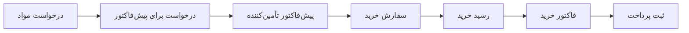

تصور کنید مسئول خرید در Nova Industries هستید؛ شرکتی که تجهیزات الکترونیکی تولید و توزیع می‌کند. تولید ماه آینده به 2,000 آداپتور برق نیاز دارد، اما ثبت سفارش فقط بخشی از کار است. تیم شما باید تأمین‌کنندگان را مقایسه کند، دربارهٔ قیمت و تحویل توافق کند، کالای رسیده را ثبت کند، صورتحساب را بررسی کند و مبلغ درست را بپردازد. اگر این مراحل در ایمیل‌ها و صفحه‌گسترده‌ها پراکنده باشند، ممکن است سفارش دوباره ثبت شود، تحویلی از قلم بیفتد یا بابت کالایی که هرگز نرسیده پرداخت کنید.

ماژول **خرید** تمام فرایند خرید را به‌هم‌پیوسته نگه می‌دارد. یک درخواست می‌تواند به استعلام از تأمین‌کننده، سفارش تأییدشده، رسید انبار، صورتحساب و در نهایت پرداخت تبدیل شود. هر سند به پرسشی متفاوت پاسخ می‌دهد؛ بنابراین می‌توانید برای خریدهای کنترل‌شده از کل گردش‌کار و برای خریدهای ساده از مسیر کوتاه‌تر استفاده کنید.

## آشنایی با چرخهٔ استاندارد خرید

گردش‌کار استاندارد برای تولیدکنندگان، توزیع‌کنندگان، خرده‌فروشان و کسب‌وکارهایی مناسب است که پیش از پرداخت به تأمین‌کننده، کالای فیزیکی را دریافت می‌کنند.

[درخواست مواد](https://docs.frappe.io/erpnext/material-request)، [درخواست برای پیش‌فاکتور](https://docs.frappe.io/erpnext/request-for-quotation) و [پیش‌فاکتور تأمین‌کننده](https://docs.frappe.io/erpnext/supplier-quotation) سندهای اختیاری برای برنامه‌ریزی و مقایسه‌اند. آن‌ها به تصمیم‌گیری دربارهٔ کالای موردنیاز و تأمین‌کننده کمک می‌کنند، اما موجودی را جابه‌جا نمی‌کنند و ثبت حسابداری ایجاد نمی‌کنند.

[سفارش خرید](purchase-order.md) تعهد تجاری شما به تأمین‌کننده است. اقلام توافق‌شده، مقدارها، نرخ‌ها، تاریخ‌های تحویل، مالیات و شرایط را ثبت می‌کند. ثبت نهایی آن به موجودی اضافه نمی‌کند و در دفترکل هم سندی ایجاد نمی‌کند.

[رسید خرید](https://docs.frappe.io/erpnext/purchase-receipt) آنچه را که واقعاً تحویل گرفته‌اید ثبت می‌کند. برای اقلام انبارشونده، موجودی را افزایش می‌دهد و در صورت فعال‌بودن موجودی دائمی، ثبت حسابداری متناظر موجودی را هم ایجاد می‌کند. با رسید جزئی، مقدار باقیماندهٔ سفارش باز می‌ماند.

[فاکتور خرید](https://docs.frappe.io/erpnext/purchase-invoice) مبلغی را که تأمین‌کننده صورتحساب کرده است ثبت می‌کند و سندهای حسابداری پرداختنی و هزینه، دارایی یا موجودی را می‌سازد. [ثبت پرداخت](https://docs.frappe.io/erpnext/payment-entry) وجه پرداخت‌شده را ثبت و ماندهٔ بدهی به تأمین‌کننده را کاهش می‌دهد.

گردش‌کار کامل، بیشترین کنترل را فراهم می‌کند؛ زیرا ERPNext می‌تواند مقدارهای سفارش‌شده، دریافت‌شده، صورتحساب‌شده و پرداخت‌شده را مقایسه کند. در مقابل، ورود سندهای بیشتری لازم دارد. وقتی تأیید تحویل، کنترل انبار یا تطبیق سه‌طرفه اهمیت دارد، از این مسیر استفاده کنید.

## انتخاب گردش‌کار متناسب با خرید

### کالای فیزیکی با رسید و صورتحساب جداگانه

وقتی تیم انبار کالا را دریافت می‌کند و تیم مالی بعداً صورتحساب تأمین‌کننده را پردازش می‌کند، از گردش‌کار استاندارد استفاده کنید.

سفارش خرید تعهد را ثبت می‌کند، رسید خرید بر موجودی اثر می‌گذارد، فاکتور خرید بر دفترکل و ماندهٔ تأمین‌کننده اثر دارد و ثبت پرداخت مانده را تسویه می‌کند. در صورت نیاز به تأیید، دریافت چند پیشنهاد یا بازرسی ورودی، می‌توانید درخواست مواد، درخواست برای پیش‌فاکتور، پیش‌فاکتور تأمین‌کننده و [بازرسی کیفیت](https://docs.frappe.io/erpnext/quality-inspection) را هم اضافه کنید.

### صورتحساب مستقیم همراه با به‌روزرسانی موجودی

خرده‌فروشان کوچک یا تیم‌هایی که گاه‌به‌گاه خرید حضوری انجام می‌دهند، ممکن است کالا و صورتحساب را هم‌زمان دریافت کنند. این افراد می‌توانند به‌جای ساخت رسید خرید جداگانه، در فاکتور خرید گزینهٔ **به‌روزرسانی موجودی** را فعال کنند.

این کوتاه‌ترین گردش‌کار خرید کالا است. با ثبت نهایی صورتحساب، هم موجودی و هم حسابداری به‌روز می‌شوند. این روش در زمان صرفه‌جویی می‌کند، اما تأیید انبار را از تأیید صورتحساب جدا نمی‌کند. اگر رسید خرید قبلاً همان کالا را ثبت کرده است، از **به‌روزرسانی موجودی** استفاده نکنید؛ چون حرکت موجودی دوباره ثبت می‌شود.

### خدمات و خریدهای غیرانبارشونده

شرکت مشاوره، نرم‌افزار یا تیم تعمیر و نگهداری ممکن است مشاورهٔ حقوقی، میزبانی ابری، حمل‌ونقل یا خدمات دیگری بخرد که وارد انبار نمی‌شوند.

وقتی خدمت به تأیید یا تعهد رسمی نیاز دارد، سفارش خرید مفید است. معمولاً رسید خرید لازم نیست، چون کالایی برای دریافت در انبار وجود ندارد. فاکتور خرید هزینه و بدهی پرداختنی را ثبت می‌کند و ثبت پرداخت تسویه را ثبت می‌کند.

### تولید پیمانکاری

ممکن است تولیدکننده مواد اولیه را برای بخشی از فرایند تولید به تأمین‌کننده بفرستد. وقتی Nova قطعه‌ها را به شریک مونتاژ می‌سپارد و کالای نهایی یا نیمه‌ساخته را تحویل می‌گیرد، از [پیمانکاری فرعی](https://docs.frappe.io/erpnext/subcontracting) استفاده کنید.

این گردش‌کار هم خدمت تأمین‌کننده و هم مواد شرکت نزد تأمین‌کننده را پیگیری می‌کند. برای فهرست مواد (BOM) درست و انبارهای پیمانکاری نیاز دارد. در مقایسه با خرید خدمت معمولی کنترل بیشتری فراهم می‌کند، اما تطبیق موجودی را نیز با دقت بیشتری می‌طلبد.

## ساخت مستقیم سند بعدی چه پیامدی دارد؟

ERPNext می‌تواند اجازه دهد رسید خرید یا فاکتور خرید بدون سفارش خرید ایجاد شود و صورتحساب نیز بدون رسید ساخته شود. این قواعد در [تنظیمات خرید](buying-settings.md) کنترل می‌شوند و برای صدور مستقیم صورتحساب ممکن است استثناهایی در سطح تأمین‌کننده وجود داشته باشد.

سند مستقیم همچنان اثر معمول خودش بر موجودی یا حسابداری را دارد؛ اما پیوند آن با تعهد قبلی از دست می‌رود. برای مثال، فاکتور خرید مستقیم بدهی پرداختنی را ثبت می‌کند، اما پیشرفت دریافت یا صدور صورتحساب سفارش خریدای را که به آن ارجاع نشده به‌روز نمی‌کند.

برای گردش‌کارهای واقعاً کوتاه از سند مستقیم استفاده کنید، نه برای دورزدن سفارش یا رسیدی که از قبل وجود دارد. ساخت صورتحساب دوم و بدون پیوند می‌تواند بدهی به تأمین‌کننده را بیش از مقدار واقعی نشان دهد.

## شروع با اطلاعات پایهٔ خرید

برای هر طرف بیرونی که از او خرید می‌کنید، یک [تأمین‌کننده](https://docs.frappe.io/erpnext/supplier) ایجاد کنید. در این مثال، Keystone Cables آداپتور برق و کابل را برای Nova Industries تأمین می‌کند. در رکورد تأمین‌کننده می‌توان مقدارهای پیش‌فرضی مانند ارز، فهرست قیمت، شرایط پرداخت، دستهٔ مالیاتی و حساب‌های پرداختنی مختص شرکت را نگه داشت.

برای محصول‌ها، مواد اولیه، دارایی‌ها یا خدماتی که می‌خرید، کالا ایجاد کنید. پیش از ورود کاربران به تراکنش‌ها، انبارهای کالای فیزیکی، لیست قیمتهای خرید برای نرخ‌های قابل‌استفادهٔ مجدد، مالیات‌ها و شرایط پرداخت را پیکربندی کنید.

تنظیمات خرید را با تیم‌های خرید، انبار، مالی و تولید بازبینی کنید. تنظیمات در کل سایت اعمال می‌شوند و می‌توانند الزام به سفارش یا رسید، کنترل تغییر نرخ، تعیین دامنهٔ مجاز مقدار و خودکارسازی بخشی از پیمانکاری را فعال کنند.

## پایش فرایندهای خرید

از فضای کاری خرید برای مشاهدهٔ سفارش‌هایی استفاده کنید که هنوز باید دریافت یا صورتحساب شوند. [گزارش‌های خرید](buying_reports.md) خرید را بر اساس تأمین‌کننده، قلم، دوره یا بُعدهای دیگر مقایسه می‌کند. حساب‌های پرداختنی صورتحساب‌های تسویه‌نشده را نشان می‌دهد و گزارش‌های موجودی مشخص می‌کنند چه چیزی به هر انبار رسیده است.

وضعیت سند نیز مفید است. سفارش با وضعیت **برای دریافت و صورتحساب** هنوز به هر دو اقدام نیاز دارد. **برای دریافت** یعنی صورتحساب کامل شده اما دریافت کامل نیست. **برای صورتحساب** یعنی کالا دریافت شده اما صورتحساب تأمین‌کننده هنوز نرسیده است. **تکمیل شده** یعنی مقدار هر دو کامل شده است.

## پرسش‌های رایج

### آیا هر خریدی باید با درخواست مواد شروع شود؟

خیر. درخواست مواد اختیاری است و زمانی مفید است که تیم دیگری نیاز را مطرح کند یا خرید به صف تأیید نیاز داشته باشد. وقتی نیاز قبلاً تأیید شده، خریدار مجاز می‌تواند مستقیماً سفارش خرید بسازد.

### آیا سفارش خرید یک سند حسابداری است؟

سفارش خرید تعهد و تحویل موردانتظار را ثبت می‌کند، نه سند حسابداری را. بسته به گردش‌کار، حسابداری وقتی آغاز می‌شود که کالا در حالت موجودی دائمی دریافت شود یا صورتحساب تأمین‌کننده ثبت نهایی شود.

### آیا برای خدمات می‌توان رسید خرید ساخت؟

بله، اما بیشتر خریدهای خدماتی به آن نیاز ندارند، چون جابه‌جایی موجودی ندارند. اگر تأیید اهمیت دارد سفارش خرید بسازید و پس از صدور صورتحساب خدمت از طرف تأمین‌کننده، فاکتور خرید ایجاد کنید.

### آیا می‌توان یک سفارش خرید را چندبخشی دریافت یا صورتحساب کرد؟

بله. از یک سفارش خرید چند رسید خرید یا فاکتور خرید بسازید. ERPNext مقدارهای تکمیل‌شده و باقیمانده را در هر ردیف قلم پیگیری می‌کند.

### اگر قیمت صورتحساب تأمین‌کننده با سفارش فرق داشت چه کنیم؟

تنظیمات خرید می‌تواند هنگام تغییر نرخ در مراحل بعدی خرید، کاربر را متوقف یا هشدار دهد. اگر تغییر معتبر است، سفارش را اصلاح کنید یا از فرایند لغو مجاز استفاده کنید؛ به‌جای آنکه صورتحسابی بدون پیوند بسازید.

## یادگیری فرایند کامل

برای توضیح گام‌به‌گام گردش‌کار خرید، [دورهٔ تدارکات مدرسه Frappe](https://school.frappe.io/lms/courses/procurement) را ببینید.

## موضوعات مرتبط

- [تنظیمات خرید](buying-settings.md)
- [تأمین‌کننده](https://docs.frappe.io/erpnext/supplier)
- [سفارش خرید](purchase-order.md)
- [رسید خرید](https://docs.frappe.io/erpnext/purchase-receipt)
- [فاکتور خرید](https://docs.frappe.io/erpnext/purchase-invoice)
- [ثبت پرداخت](https://docs.frappe.io/erpnext/payment-entry)
- [پیمانکاری فرعی](https://docs.frappe.io/erpnext/subcontracting)

منبع: [آشنایی با ماژول خرید](https://docs.frappe.io/erpnext/buying). این صفحه ترجمهٔ غیررسمی است؛ محتوای مستندات تحت شرایط CC BY-SA منتشر شده و این ترجمه نیز با انتساب به منبع بازنشر می‌شود. تصویر به فایل رسمی مستندات پیوند داده شده و در این مخزن بازنشر نشده است.
