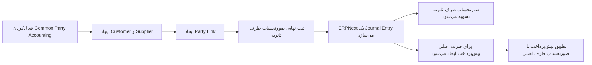

> این صفحه ترجمهٔ غیررسمی مستندات ERPNext است. [مشاهدهٔ منبع اصلی](https://docs.frappe.io/erpnext/common-party-accounting)
> متن این صفحه ترجمه و اقتباسی از منبع بالاست و تحت شرایط CC BY-SA آن منبع بازنشر می‌شود (نسخه در سیاست منبع مشخص نشده است). این ترجمه مستقل و غیررسمی است.
>
> تصویرهای صفحهٔ منبع بازنشر نشده‌اند؛ مجوز جداگانهٔ آن‌ها تأیید نشده است.

وقتی یک سازمان واقعی هم‌زمان مشتری و تأمین‌کننده شماست و قصد دارید مطالبات و بدهی‌های مجاز میان دو رکورد طرف تجاری آن تهاتر شوند، از **Common طرف حسابداری** استفاده کنید.

ERPNext، [مشتری](customer.md) و [تأمین‌کننده](https://docs.frappe.io/erpnext/supplier) را به‌صورت اطلاعات پایهٔ جدا نگه می‌دارد؛ چون رفتار فروش، خرید، قیمت‌گذاری، مالیات، اعتبار و پرتال آن‌ها متفاوت است. یک **لینک طرف** به ERPNext می‌گوید این دو رکورد برای این گردش‌کار حسابداری، معرف یک طرف تجاری واحد هستند.

برای نمونه، شرکت Nova Electronics Trading از Vertex Components خدمات می‌خرد و 1,200 دلار به آن بدهکار است. سپس Vertex خدمات راه‌اندازی دستگاه به ارزش 800 دلار از Nova می‌خرد. وقتی رکوردها پیوند داده شده‌اند و تأمین‌کننده طرف اصلی و مشتری طرف ثانویه است، ثبت نهایی [فاکتور فروش](https://docs.frappe.io/erpnext/sales-invoice) به مبلغ 800 دلار، یک [ثبت در دفتر روزنامه](https://docs.frappe.io/erpnext/journal-entry) سیستمی ایجاد می‌کند. فاکتور فروش تسویه می‌شود و 800 دلار پیش‌پرداخت تأمین‌کننده برای تطبیق با [فاکتور خرید](https://docs.frappe.io/erpnext/purchase-invoice) به مبلغ 1,200 دلار در دسترس قرار می‌گیرد؛ در نتیجه 400 دلار بدهی باقی می‌ماند.

## چه زمانی از این قابلیت استفاده کنیم؟

در این شرایط از Common طرف حسابداری استفاده کنید:

- یک طرف حقوقی یا تجاری واحد هم به‌عنوان مشتری و هم تأمین‌کننده ثبت شده باشد؛
- سیاست سازمان اجازه دهد ماندهٔ مطالبات و بدهی آن طرف با هم تهاتر شوند؛
- بخواهید ERPNext هنگام ثبت نهایی صورتحساب واجد شرایطِ طرف ثانویه، تعدیل حسابداری بین دو طرف را خودکار بسازد؛
- تیم مالی، ثبت در دفتر روزنامه ایجادشده را بازبینی کند و پیش‌پرداخت حاصل را تطبیق دهد.

این قابلیت را صرفاً برای نشان‌دادن ارتباط دو رکورد اطلاعات پایه فعال نکنید؛ این ویژگی عملیات حسابداری را خودکار می‌کند. اگر صورتحساب‌ها باید معمولاً مستقل بمانند، مشتری و تأمین‌کننده جداگانه را حفظ کنید، برای مشاهدهٔ ارتباط [مخاطب (Contact)](contact.md) و [نشانی](address.md) آن‌ها را پیوند دهید و فقط زمانی که سیاست اجازه می‌دهد تعدیلی هدفمند ثبت کنید.

## آشنایی با گردش‌کار

جهت پیوند اهمیت دارد:

| نقش اصلی | نقش ثانویه | صورتحساب ثبت نهایی‌شده برای طرف ثانویه | نتیجهٔ خودکار |
| --- | --- | --- | --- |
| تأمین‌کننده | مشتری | فاکتور فروش | مطالبات مشتری را در برابر فاکتور فروش بستانکار می‌کند و به‌عنوان پیش‌پرداخت تخصیص‌نیافتهٔ تأمین‌کننده، حساب‌های پرداختنی را بدهکار می‌کند. |
| مشتری | تأمین‌کننده | فاکتور خرید | هنگام تسویهٔ صورتحساب تأمین‌کننده پیوندخورده، پیش‌پرداخت متناظر در سمت مشتری ایجاد می‌کند. |

پیش از فعال‌کردن این فرایند برای کاربران عادی، جهت پیوند را با صورتحساب‌های نمونه و کنترل‌شده آزمایش کنید.

## پیش از شروع

بررسی کنید که:

1. هر دو رکورد طرف تجاری معرف یک موجودیت واحد باشند؛
2. ارز شرکت و طرف‌های تجاری با تعدیل موردنظر سازگار باشد؛
3. حساب‌های دریافتنی و پرداختنی درست پیکربندی شده باشند؛
4. کاربر بتواند صورتحساب‌ها را ثبت نهایی کند و ثبت در دفتر روزنامه ایجادشده را بازبینی کند؛
5. تیم مالی مشخص کرده باشد تهاتر بین دو طرف در چه شرایطی مجاز است؛
6. اگر قرار است پیش‌پرداخت جدید بی‌درنگ تخصیص یابد، صورتحساب تسویه‌نشده‌ای برای طرف اصلی وجود داشته باشد.

## فعال‌کردن Common طرف حسابداری

1. **تنظیمات حساب‌ها** را باز کنید.
2. **فاکتور و صورتحساب** را انتخاب کنید.
3. گزینهٔ **فعال کردن حسابداری طرف مشترک** را فعال کنید.
4. تنظیمات حساب‌ها را ذخیره کنید.

این تنظیم در سطح سایت اعمال می‌شود. وقتی این قابلیت فعال باشد، کلید جداگانه‌ای در سطح صورتحساب برای جلوگیری از تعدیل خودکار وجود ندارد. فقط پس از تأیید سیاست و نتیجهٔ آزمایش، آن را فعال کنید.

## ایجاد یا شناسایی رکوردهای هر دو طرف

با گردش‌کار معمول اطلاعات پایه، مشتری و تأمین‌کننده را ایجاد کنید. چون این دو از DocTypeهای متفاوت هستند، می‌توانند نام یکسان داشته باشند. جزئیات مالیاتی، ارز، شرایط پرداخت، کنترل اعتبار، Contactها، Addressها و پیش‌فرض‌های شرکت را در هر رکورد درست نگه دارید.

این دو رکورد را ادغام نکنید و دفتر کل مشترک دریافتنی و پرداختنی نسازید. ERPNext همچنان مشتری را در حساب دریافتنی و تأمین‌کننده را در حساب پرداختنی ثبت می‌کند.

## پیوند دادن مشتری و تأمین‌کننده

اگر تأمین‌کننده از قبل وجود دارد:

1. تأمین‌کننده را باز کنید.
2. **Actions > Link with مشتری** را انتخاب کنید.
3. مشتری متناظر را انتخاب یا ایجاد کنید.

اگر مشتری از قبل وجود دارد، آن را باز کنید و به‌جای آن **Actions > Link with تأمین‌کننده** را انتخاب کنید.

ERPNext یک لینک طرف می‌سازد. نقش‌ها و طرف‌ها را با دقت بررسی کنید؛ جهت Primary و Secondary تعیین می‌کند کدام صورتحساب ثبت خودکار را فعال می‌کند و پیش‌پرداخت برای کدام طرف ایجاد می‌شود.

| فیلد | مفهوم |
| --- | --- |
| Primary نقش | نقشی که پس از تسویهٔ صورتحساب طرف ثانویه، پیش‌پرداخت تخصیص‌نیافته را دریافت می‌کند. |
| Primary طرف | رکورد مشتری یا تأمین‌کننده در نقش اصلی. |
| Secondary نقش | نقش طرف مقابل که صورتحساب آن تعدیل خودکار را فعال می‌کند. |
| Secondary طرف | رکورد مشتری یا تأمین‌کننده پیوندخورده در نقش ثانویه. |

## ثبت نهایی صورتحساب طرف ثانویه

صورتحساب را با گردش‌کار معمول ایجاد و ثبت نهایی کنید. در این مثال، Vertex Components هم تأمین‌کننده اصلی است و هم مشتری ثانویه؛ بنابراین فاکتور فروش صورتحسابی است که فرایند را فعال می‌کند.

پس از ثبت نهایی، مبلغ تسویه‌نشدهٔ فاکتور فروش به مبلغ 800 دلار، صفر می‌شود؛ چون ثبت در دفتر روزنامه ایجادشده، دریافتنی آن را تسویه می‌کند.

ERPNext یک ثبت در دفتر روزنامه سیستمی ایجاد و ثبت نهایی می‌کند:

| حساب و طرف تجاری | بدهکار | بستانکار | نتیجه |
| --- | ---: | ---: | --- |
| Debtors، مشتری با نام Vertex Components | 0 دلار | 800 دلار | دریافتنی فاکتور فروش را تسویه می‌کند. |
| Creditors، تأمین‌کننده با نام Vertex Components | 800 دلار | 0 دلار | پیش‌پرداخت تخصیص‌نیافتهٔ تأمین‌کننده را ایجاد می‌کند. |

پیش از تطبیق، ثبت ایجادشده را بازبینی کنید. شرکت، طرف‌ها، حساب‌ها، مبالغ، ارجاع صورتحساب، ارزها و تاریخ ثبت را تأیید کنید. ممکن است شمارهٔ ثبت در دفتر روزنامه در [دفترکل](https://docs.frappe.io/erpnext/general-ledger) دیده شود؛ چون این سند همان واچری است که تعدیل بین دو طرف را انجام می‌دهد.

## تطبیق پیش‌پرداخت

مبلغ ایجادشده برای طرف اصلی تا زمان تخصیص، پیش‌پرداخت است. برای تطبیق آن با صورتحساب تسویه‌نشدهٔ همان طرف، از [تطبیق پرداخت](https://docs.frappe.io/erpnext/payment-reconciliation) استفاده کنید.

1. تطبیق پرداخت را باز کنید.
2. شرکت، **نوع طرف** اصلی و **طرف** اصلی را انتخاب کنید.
3. در صورت نیاز، نتایج را به صورتحساب و ثبت در دفتر روزنامه ایجادشده محدود کنید.
4. **دریافت ثبت‌های ناسازگار** را انتخاب کنید.
5. ردیف‌های صورتحساب و ثبت در دفتر روزنامه را انتخاب کنید.
6. **تخصیص** را انتخاب کنید.
7. مبلغ تخصیص را بررسی و سپس **وفق دادن** را انتخاب کنید.

در این مثال، پیش‌پرداخت 800 دلاری، مبلغ تسویه‌نشدهٔ فاکتور خرید به مبلغ 1,200 دلار را به 400 دلار کاهش می‌دهد.

## رفتارهای مهم

| رفتار | انتظار چه چیزی را داشته باشید |
| --- | --- |
| اطلاعات پایهٔ جداگانه | مشتری و تأمین‌کننده رکوردهای مجزا باقی می‌مانند. |
| ثبت خودکار | صورتحساب واجد شرایطِ طرف ثانویه، ثبت در دفتر روزنامه سیستمیِ ثبت‌نهایی‌شده ایجاد می‌کند. |
| صورتحساب محرک | ثبت در دفتر روزنامه خودکار، صورتحساب طرف ثانویه را تسویه می‌کند. |
| ماندهٔ طرف اصلی | سمت مقابل به پیش‌پرداخت تخصیص‌نیافته برای طرف اصلی تبدیل می‌شود. |
| تطبیق | پیش‌پرداخت تا زمان تطبیق به صورتحساب طرف اصلی متصل نیست. |
| گزارش‌گیری | مانده‌های مشتری و تأمین‌کننده را جداگانه بررسی و ثبت در دفتر روزنامه ایجادشده را ردیابی کنید. |
| برگشت و اصلاح | حسابداری حاصل را با دقت بررسی کنید. فرض نکنید هر برگشت یا اصلاح بعدی به‌طور خودکار قصد تجاری شما را منعکس می‌کند. |

## عیب‌یابی

| مشکل | موردی که باید بررسی شود |
| --- | --- |
| گزینهٔ پیوند در دسترس نیست | تأیید کنید Common طرف حسابداری فعال باشد و طرف تجاری از قبل پیوند نخورده باشد. |
| ثبت در دفتر روزنامه خودکار ایجاد نمی‌شود | بررسی کنید صورتحساب برای طرف **ثانویه** در لینک طرف ثبت نهایی شده باشد و تنظیم پیش از ثبت نهایی فعال بوده باشد. |
| پیش‌پرداخت برای طرف اشتباه ایجاد می‌شود | نقش Primary طرف و Secondary طرف را بازبینی کنید. |
| پیش‌پرداخت در تطبیق دیده نمی‌شود | نوع طرف و طرف اصلی، حساب پرداختنی یا دریافتنی درست و بازهٔ تاریخ ثبت در دفتر روزنامه را انتخاب کنید. |
| دفتر کل ماندهٔ ترکیبی طرف را نشان نمی‌دهد | مشتری و تأمین‌کننده از نوع‌های طرف جداگانه هستند. هر طرف و ثبت در دفتر روزنامه ایجادشده را بررسی کنید؛ انتظار دفتر کل ادغام‌شده نداشته باشید. |

## پرسش‌های رایج

### آیا لینک طرف، مشتری و تأمین‌کننده را ادغام می‌کند؟

خیر. این پیوند دو رکورد اطلاعات پایهٔ جداگانه را برای گردش‌کار حسابداری به هم مرتبط می‌کند. رفتار فروش، خرید، مالیات، ارز و مجوزهای آن‌ها جدا باقی می‌ماند.

### آیا می‌توان پیوند را بدون ثبت در دفتر روزنامه خودکار فعال کرد؟

تنظیم کنونی Common طرف حسابداری برای خودکارسازی ثبت بین دو طرف در صورتحساب‌های واجد شرایط طراحی شده است. کلید بومی جداگانه‌ای وجود ندارد که این پیوندِ خودکارسازی‌محور را نگه دارد اما ثبت‌های ایجادشده را غیرفعال کند.

### چرا صورتحساب طرف ثانویه از قبل پرداخت‌شده است؟

ثبت در دفتر روزنامه سیستمی به آن صورتحساب ارجاع می‌دهد و آن را تسویه می‌کند. سمت مقابل به پیش‌پرداخت طرف اصلی تبدیل می‌شود و سپس می‌توان آن را تطبیق داد.

### آیا ERPNext صورتحساب طرف اصلی را خودکار انتخاب می‌کند؟

خیر. مبلغ ایجادشده تا زمانی که صورتحساب تسویه‌نشدهٔ درست را در تطبیق پرداخت انتخاب نکنید، تخصیص‌نیافته می‌ماند.

### آیا می‌توان تراکنش‌های مشتری و تأمین‌کننده را در یک فیلتر استاندارد طرف در دفترکل دید؟

این‌ها دو نوع طرف جداگانه هستند. هر سمت را جدا بررسی کنید و برای ردیابی ارتباط از لینک طرف و ثبت در دفتر روزنامه ایجادشده کمک بگیرید. اگر سازمان به نمای یکپارچه نیاز دارد، ممکن است گزارش سفارشی لازم باشد.

## موضوعات مرتبط

- [مشتری](customer.md)
- [تأمین‌کننده](https://docs.frappe.io/erpnext/supplier)
- [فاکتور فروش](https://docs.frappe.io/erpnext/sales-invoice)
- [فاکتور خرید](https://docs.frappe.io/erpnext/purchase-invoice)
- [ثبت در دفتر روزنامه](https://docs.frappe.io/erpnext/journal-entry)
- [تطبیق پرداخت](https://docs.frappe.io/erpnext/payment-reconciliation)
- [دفترکل](https://docs.frappe.io/erpnext/general-ledger)
