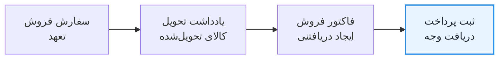
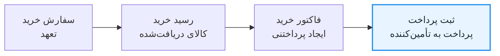

## چرا از ثبت پرداخت استفاده کنیم؟

هرگاه پولی دریافت، پرداخت یا میان حساب‌های بانکی و نقدی جابه‌جا می‌شود، از سند ثبت پرداخت استفاده کنید. این سند استاندارد عملیاتی برای ثبت دریافت از مشتری، پرداخت به تأمین‌کننده، پیش‌پرداخت، پرداخت جزئی، پرداخت چند فاکتور یا انتقال داخلی میان حساب‌هاست.

ثبت پرداخت فقط ردیف‌های بدهکار و بستانکار ایجاد نمی‌کند؛ می‌تواند وجه را به [فاکتور فروش](sales-invoice.md)، [فاکتور خرید](purchase-invoice.md)، سفارش فروش، سفارش خرید یا مرجع پشتیبانی‌شدهٔ دیگری پیوند دهد. سپس ERPNext مبلغ تخصیص‌یافته و تسویه‌نشده را به‌روز می‌کند. پیش‌پرداخت یا پرداخت مستقل می‌تواند بدون تخصیص باقی بماند و بعداً با [تطبیق پرداخت](https://docs.frappe.io/erpnext/payment-reconciliation) به سند مربوط وصل شود.

فرم راهنمای ثبت پرداخت، طرف حساب، روش پرداخت، حساب بانکی یا نقدی، شمارهٔ مرجع، ارزها، نرخ تبدیل، کسورات و تخصیص فاکتورها را نیز ثبت می‌کند. این کار مسیر پرداخت را روشن‌تر می‌کند و احتمال انتخاب دستی حساب بدهکار یا بستانکار نادرست را کاهش می‌دهد.

## اثر ثبت پرداخت بر دفتر کل

با ثبت نهایی سند ثبت پرداخت، ردیف‌هایی در دفتر کل ایجاد می‌شوند. نام دقیق حساب‌ها به درخت حساب‌های شما بستگی دارد، اما ثبت‌های معمول چنین‌اند:

| نوع پرداخت | بدهکار | بستانکار | نتیجهٔ عملیاتی |
|---|---|---|---|
| **دریافت** | بانک یا صندوق | دریافتنی مشتری | وجه در حساب بانکی یا نقدی انتخاب‌شده افزایش می‌یابد. اگر به فاکتور فروش تخصیص یابد، مبلغ تسویه‌نشدهٔ آن کم می‌شود. |
| **پرداخت** | پرداختنی تأمین‌کننده | بانک یا صندوق | بدهی به تأمین‌کننده کم می‌شود و وجه از حساب بانکی یا نقدی انتخاب‌شده خارج می‌شود. اگر به فاکتور خرید تخصیص یابد، مبلغ تسویه‌نشدهٔ آن کاهش می‌یابد. |
| **انتقال داخلی** | حساب بانکی یا نقدی مقصد | حساب بانکی یا نقدی مبدأ | وجه میان حساب‌های شرکت جابه‌جا می‌شود و مانده‌ای برای مشتری یا تأمین‌کننده ایجاد نمی‌کند. |

ثبت پرداخت معمولاً مبلغی را تسویه می‌کند که تراکنش دیگری قبلاً شناسایی کرده است. برای نمونه، فاکتور فروش درآمد و دریافتنی مشتری را ثبت می‌کند. ثبت پرداخت بعدی آن مبلغ را از دریافتنی به بانک یا صندوق منتقل می‌کند؛ درآمد فروش را دوباره ثبت نمی‌کند.

## ثبت پرداخت یا ثبت روزنامه؟

وقتی رویداد اصلی جابه‌جایی وجه است، از ثبت پرداخت استفاده کنید. وقتی رویداد اصلی تعدیل حسابداری است و پرداختی به مشتری یا تأمین‌کننده انجام نمی‌شود، از [ثبت در دفتر روزنامه](https://docs.frappe.io/erpnext/journal-entry) استفاده کنید.

| وضعیت | از چه چیزی استفاده کنید؟ | دلیل |
|---|---|---|
| دریافت وجه از مشتری | ثبت پرداخت | دریافت بانکی، طرف حساب، ارجاع‌ها و تخصیص فاکتور را ثبت می‌کند. |
| پرداخت به تأمین‌کننده | ثبت پرداخت | پرداخت بانکی را ثبت و بدهی انتخاب‌شده را کاهش می‌دهد. |
| ثبت پیش‌پرداخت یا پرداخت جزئی | ثبت پرداخت | مبالغ تخصیص‌نیافته و تطبیق بعدی را پشتیبانی می‌کند. |
| انتقال وجه میان حساب‌های بانکی یا نقدی | ثبت پرداخت | نوع انتقال داخلی، گردش راهنمای انتقال میان حساب‌ها را فراهم می‌کند. |
| سوخت مطالبات، تعهد هزینه، طبقه‌بندی دوبارهٔ مانده یا تعدیل حسابداری | ثبت روزنامه | چون هدف تعدیل دفترکل است، حساب‌های بدهکار و بستانکار را خودتان کنترل می‌کنید. |

برای **ثبت پرداخت** هنگام دریافت، پرداخت یا انتقال وجه میان حساب‌ها استفاده کنید. ERPNext کمک می‌کند:

- حساب بانکی، نقدی، مشتری و تأمین‌کنندهٔ درست را انتخاب کنید؛
- وجه دریافتی از مشتری یا پرداختی به تأمین‌کننده را ثبت کنید؛
- وجه را میان حساب‌های بانکی یا نقدی انتقال دهید؛
- پرداخت را به یک یا چند فاکتور پیوند دهید؛
- مبلغ تسویه‌نشدهٔ فاکتورها را خودکار به‌روز کنید؛
- پرداخت کامل، پرداخت جزئی و پیش‌پرداخت را ثبت کنید؛
- ارزها را مدیریت و ارجاع بانکی، شمارهٔ چک و تاریخ پرداخت را نگهداری کنید؛
- پرداخت‌های تخصیص‌نیافته را برای تطبیق بعدی حفظ کنید؛
- هنگام ثبت نهایی، ردیف‌های لازم دفتر کل را بسازید.

### چرا برای پرداخت‌های معمول از ثبت روزنامه استفاده نکنیم؟

ثبت روزنامه هم می‌تواند برخی جابه‌جایی‌های بانکی یا نقدی را ثبت کند، اما باید:

- حساب‌های بدهکار و بستانکار را خودتان انتخاب کنید؛
- مبلغ درست را در هر طرف وارد کنید؛
- روش حسابداری موردنیاز را بدانید؛
- برای جلوگیری از ثبت در حساب نادرست دقت بیشتری به‌خرج دهید.

اگر پرداخت‌ها را با ثبت روزنامه وارد کنید، نمی‌توانید دریافتنی‌ها را پیگیری کنید، فاکتورها را تطبیق دهید و چرخهٔ فروش یا خرید را کامل کنید.

برای بیشتر دریافت‌های مشتری، پرداخت‌های تأمین‌کننده، پیش‌پرداخت‌ها و انتقال‌های بانکی، از **ثبت پرداخت** استفاده کنید. **ثبت روزنامه** را عمدتاً برای تعدیل‌های حسابداری به‌کار ببرید، زمانی که پرداخت واقعی انجام نمی‌شود.

## جایگاه ثبت پرداخت در چرخهٔ کسب‌وکار

در گردش‌کار استانداردی که با فاکتور آغاز می‌شود، ثبت پرداخت گام تسویه در پایان چرخهٔ فروش و خرید است. سفارش، تعهد را ثبت می‌کند؛ تحویل یا دریافت، جابه‌جایی کالا را ثبت می‌کند؛ فاکتور، مبلغ سررسیدشده را ثبت می‌کند؛ و ثبت پرداخت، وجه دریافتی یا پرداختی را ثبت می‌کند.

### چرخهٔ فروش

وقتی مشتری پرداخت می‌کند، از نوع **دریافت** در ثبت پرداخت استفاده کنید. ERPNext حساب بانکی یا نقدی را بدهکار، حساب‌های دریافتنی را بستانکار و مبلغ تسویه‌نشدهٔ فاکتور فروش را کاهش می‌دهد.

### چرخهٔ خرید

وقتی به تأمین‌کننده پول می‌دهید، از نوع **پرداخت** در ثبت پرداخت استفاده کنید. ERPNext حساب‌های پرداختنی را بدهکار، حساب بانکی یا نقدی را بستانکار و مبلغ تسویه‌نشدهٔ فاکتور خرید را کاهش می‌دهد.

| چرخه | نوع پرداخت | بدهکار | بستانکار | نتیجه |
|---|---|---|---|---|
| فروش | دریافت | بانک یا صندوق | حساب‌های دریافتنی | بدهی مشتری کاهش می‌یابد. |
| خرید | پرداخت | حساب‌های پرداختنی | بانک یا صندوق | بدهی شرکت به تأمین‌کننده کاهش می‌یابد. |

**ثبت پرداخت همیشه آخرین سند نیست.** اگر پیش‌پرداخت مشتری دریافت می‌کنید یا به تأمین‌کننده پیش‌پرداخت می‌دهید، ثبت پرداخت را پیش از فاکتور ایجاد کنید. بعداً پیش‌پرداخت را به فاکتور پیوند دهید یا تطبیق دهید تا تسویه کامل شود.

## پیش از شروع

شرکت، واحد پول، حساب دریافتنی یا پرداختنی و دفتر بانک یا صندوق درست را تأیید کنید. از سندهای مبدأ ثبت‌نهایی‌شده استفاده کنید و مرجع بانکی یا اعلامیهٔ حواله را در دسترس داشته باشید.

## ایجاد ثبت پرداخت

1. **دریافت**، **پرداخت** یا **انتقال داخلی** را انتخاب کنید.
2. شرکت، تاریخ ثبت، نحوهٔ پرداخت و طرف حساب را تعیین کنید.
3. حساب‌ها و ارزهای مبدأ و مقصد را بررسی کنید.
4. مبلغ و اطلاعات مرجع را وارد کنید.
5. از **دریافت فاکتورهای معوق** استفاده کنید یا ارجاع‌ها را دستی اضافه کنید.
6. تخصیص‌ها و کسورات را بررسی و سند را ثبت نهایی کنید.

## فیلدهای مهم و کاربرد آن‌ها

| فیلد | چه چیزی را کنترل می‌کند؟ |
|---|---|
| نوع پرداخت | دریافت، پرداخت یا انتقال داخلی. |
| نوع طرف و طرف حساب | مشتری، تأمین‌کننده، کارمند، سهام‌دار یا طرف حساب پشتیبانی‌شدهٔ دیگر. |
| پرداخت از و پرداخت به | حساب‌های دفتری مبدأ و مقصد. |
| مبلغ پرداخت‌شده و مبلغ دریافتی | مبلغ‌ها با واحد پول مربوط به هر حساب. |
| شمارهٔ مرجع و تاریخ | مدرک بانکی، چک یا انتقال وجه. |
| ارجاع‌ها | فاکتورها، سفارش‌ها یا سندهای دیگری که پرداخت در برابر آن‌ها تخصیص می‌یابد. |
| کسورات یا زیان | کارمزد بانکی، سوخت مطالبات، کسورات قانونی یا تفاوت تسعیر که با حساب‌های مشخص ثبت می‌شوند. |

## عیب‌یابی

### گزینهٔ دریافت فاکتورهای معوق، فاکتوری نشان نمی‌دهد

بررسی کنید فاکتور ثبت‌نهایی شده باشد، به طرف حساب و شرکت انتخاب‌شده تعلق داشته باشد، از همان حساب دریافتنی یا پرداختنی استفاده کند و هنوز مبلغ تسویه‌نشده داشته باشد. همچنین **از تاریخ**، **تا تاریخ** و فیلترهای دیگر پنجرهٔ فاکتورهای معوق را بررسی کنید. فاکتوری که کاملاً تخصیص یافته باشد نمایش داده نمی‌شود.

### مبلغ تفاوت صفر نیست

ابتدا مبلغ پرداخت‌شده، مبلغ دریافتی، نرخ‌های تبدیل و تخصیص فاکتورها را بررسی کنید. کارمزد بانکی، کسورات قانونی، سوخت مطالبات جزئی یا تفاوت تسعیر را در **کسورات یا زیان‌ها** و با حساب مناسب ثبت کنید. کارمزد بانکی را در مالیات و عوارض وارد نکنید، چون پولی نیست که به طرف حساب پرداخت شده باشد.

### پرداخت به فاکتور اشتباهی تخصیص یافته است

اگر مبلغ و طرف حساب درست‌اند اما تخصیص اشتباه است، از [لغو تطبیق پرداخت‌ها](https://docs.frappe.io/erpnext/unreconciliation) استفاده کنید و سپس با [تطبیق پرداخت](https://docs.frappe.io/erpnext/payment-reconciliation) پرداخت را درست تخصیص دهید. فقط زمانی ثبت پرداخت را لغو و اصلاح کنید که اطلاعات پرداخت یا حساب‌ها نادرست باشند.

### پس از پرداخت ارزی، مبلغ اندکی تسویه‌نشده باقی می‌ماند

واحد پول هر دو حساب و نرخ تبدیل مبدأ و مقصد را بررسی کنید. فاکتور را با واحد پول حساب مربوط تخصیص دهید و تفاوت واقعی تسعیر را با **کسورات یا زیان‌ها** به حساب سود یا زیان تسعیرِ پیکربندی‌شده ثبت کنید. پس از ثبت نهایی، دفتر طرف حساب را بررسی کنید.

## پرسش‌های متداول

### آیا یک ثبت پرداخت می‌تواند چند فاکتور یک طرف حساب را تسویه کند؟

بله. یک ثبت پرداخت می‌تواند چند فاکتور همان طرف حساب را تسویه کند. فاکتورهای معوق را دریافت و برای هر ارجاع مبلغی تخصیص دهید. جمع مبلغ تخصیص‌یافته می‌تواند کمتر یا برابر مبلغ پرداخت باشد، اما نباید از مبلغ در دسترس بیشتر شود.

### اگر مشتری بیش از مبلغ فاکتور انتخاب‌شده پرداخت کند چه می‌شود؟

فقط ماندهٔ فاکتور را تخصیص دهید. ERPNext باقی‌مانده را به‌عنوان پیش‌پرداخت تخصیص‌نیافتهٔ همان مشتری نگه می‌دارد تا بعداً از طریق تطبیق پرداخت یا گردش‌کار پشتیبانی‌شدهٔ فاکتور استفاده شود.

### آیا یک ثبت پرداخت می‌تواند وجه را میان چند مشتری یا تأمین‌کننده تقسیم کند؟

هر ثبت پرداخت استاندارد فقط یک طرف حساب دارد. اگر وجه به چند طرف تعلق دارد، برای هر طرف ثبت پرداخت جداگانه بسازید؛ حتی اگر بانک یک مبلغ تجمیعی واریز کرده یا پرداخت کرده باشد. سپس تراکنش بانکی را با هر ثبت جداگانه تطبیق دهید.

### آیا می‌توان برای پرداخت‌های بیش از مبلغ مشخص، تأیید لازم کرد؟

برای ثبت پرداخت، یک [گردش‌کار](https://docs.frappe.io/erpnext/workflows) با شرط‌های مبتنی بر مبلغ و نقش‌ها پیکربندی کنید. پیش از استفادهٔ عملی، وضعیت‌ها، مجوزهای گذار و افرادی را که می‌توانند سند را ثبت نهایی کنند آزمایش کنید.

### آیا می‌توانم پیش از ثبت نهایی، اثر دفترکل را ببینم؟

اگر نسخهٔ شما امکان پیش‌نمایش دفتر را دارد، از **دفتر حسابداری** یا کنش پیش‌نمایش دفترکل در سند استفاده کنید. دست‌کم حساب‌های مبدأ و مقصد، مبلغ‌ها، نرخ‌های تبدیل، تخصیص‌ها و کسورات را بررسی کنید. سند پیش‌نویس در دفتر کل ثبت نمی‌شود.

## موضوعات مرتبط

- [ثبت پرداخت](https://docs.frappe.io/erpnext/payment-entry)
- [تطبیق پرداخت](https://docs.frappe.io/erpnext/payment-reconciliation)
- [تطبیق بانکی](bank-reconciliation.md)
- [تراکنش بانکی](bank-transaction.md)
- [ثبت در دفتر روزنامه](https://docs.frappe.io/erpnext/journal-entry)

---

> این صفحه ترجمهٔ غیررسمی مستندات ERPNext است. [ثبت پرداخت](https://docs.frappe.io/erpnext/payment-entry). محتوای نوشتاری با انتساب به منبع و تحت شرایط CC BY-SA آن بازنشر می‌شود؛ نسخهٔ مجوز در سیاست منبع مشخص نشده است.
