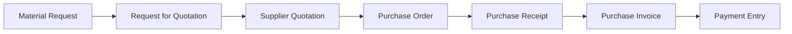
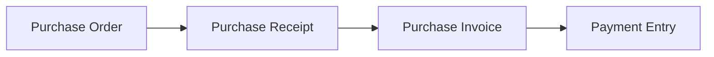
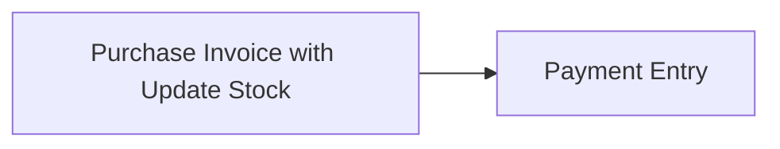
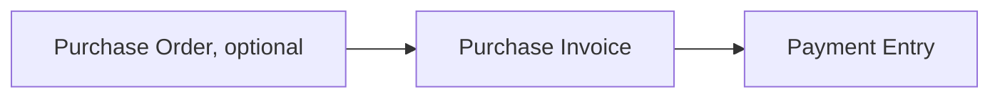
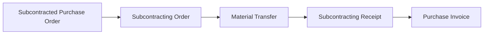

Imagine you manage purchasing at Nova Industries, a company that manufactures and distributes electronics. Production needs 2,000 power adapters next month, but placing an order is only one part of the job. Your team must compare suppliers, agree on price and delivery, record what arrived, check the bill, and pay the correct amount. If these steps live in emails and spreadsheets, it is easy to order twice, miss a delivery, or pay for material that never arrived.

The Buying module keeps that complete purchasing story connected. A request can become a supplier enquiry, an approved order, a stock receipt, an invoice, and finally a payment. Each document answers a different question, so you can use the full flow for controlled procurement or a shorter flow when the purchase is simple.

## Understand the standard buying cycle

The standard flow is suited to manufacturers, distributors, retailers, and other businesses that receive physical goods before paying the supplier.

[Material Request](/erpnext/material-request), [Request for Quotation](/erpnext/request-for-quotation), and [Supplier Quotation](/erpnext/supplier-quotation) are optional planning and comparison records. They help you decide what to buy and from whom, but they do not move stock or post accounting entries.

A [Purchase Order](/erpnext/purchase-order) is your commercial commitment to the supplier. It records agreed items, quantities, rates, delivery dates, taxes, and terms. Submitting it does not add stock and does not create a General Ledger entry.

A [Purchase Receipt](/erpnext/purchase-receipt) records what physically arrived. For stock items, it increases inventory. With perpetual inventory, it also posts the corresponding stock accounting entry. A partial receipt leaves the remaining order quantity open.

A [Purchase Invoice](/erpnext/purchase-invoice) records what the supplier has billed. It creates the payable and expense, asset, or stock-related accounting entries. A [Payment Entry](/erpnext/payment-entry) records the money paid and reduces the supplier's outstanding balance.

The full flow gives the strongest control because ERPNext can compare ordered, received, billed, and paid quantities. The trade-off is more document entry. Use it when delivery confirmation, warehouse control, or three-way matching matters.

## Choose the workflow that matches the purchase

### Physical goods with separate receipt and invoice

Use the standard flow when a warehouse team receives goods and a finance team later processes the supplier invoice.

The Purchase Order is the commitment, the Purchase Receipt affects stock, the Purchase Invoice affects the General Ledger and supplier balance, and the Payment Entry settles the balance. A Material Request, RFQ, Supplier Quotation, and [Quality Inspection](/erpnext/quality-inspection) can be added when approvals, competitive quotations, or incoming inspection are required.

### Direct invoice with stock update

Small retailers and teams making occasional counter purchases may receive the goods and invoice at the same time. They can use a Purchase Invoice with **Update Stock** instead of creating a separate Purchase Receipt.

This is the shortest goods-purchase flow. The invoice updates both stock and accounting when submitted. It saves time, but it does not separate warehouse confirmation from invoice approval. Do not use Update Stock when a Purchase Receipt has already recorded the same goods, because that would record the stock movement twice.

### Services and non-stock purchases

A consulting firm, software company, or maintenance team may buy legal advice, cloud hosting, freight, or another service that never enters a warehouse.

The Purchase Order is useful when the service needs approval or a formal commitment. The Purchase Receipt is normally skipped because there is no stock to receive. The Purchase Invoice records the expense and payable, and the Payment Entry records settlement.

### Subcontracted production

A manufacturer may send raw materials to a supplier who performs part of the production process. Use [Subcontracting](/erpnext/subcontracting) when Nova sends components to an assembly partner and receives finished or semi-finished goods back.

This flow tracks both the supplier service and the company's material at the supplier. It needs a correct Bill of Materials and subcontracting warehouses. It is more controlled than a normal service purchase, but it also needs careful stock reconciliation.

## What happens when you create a downstream document directly

ERPNext can allow a Purchase Receipt or Purchase Invoice to be created without a Purchase Order, and an invoice can be created without a receipt. These rules are controlled in [Buying Settings](/erpnext/buying-settings), with supplier-level exceptions for direct invoicing.

A direct document still creates its own normal stock or accounting effect. What you lose is the link to the earlier commitment. For example, a direct Purchase Invoice records the payable, but it does not update the received or billed progress of a Purchase Order that was never referenced.

Use direct documents for genuine short flows, not to bypass an order or receipt that already exists. Creating a second, unlinked invoice can overstate the amount owed to the supplier.

## Start with the buying masters

Create a [Supplier](/erpnext/supplier) for each external party from whom you buy. In this example, Keystone Cables supplies power adapters and cables to Nova Industries. The Supplier stores defaults such as currency, price list, payment terms, tax category, and company-specific payable accounts.

Create Items for the products, raw materials, assets, or services you purchase. Configure Warehouses for physical stock, buying Price Lists for reusable rates, and taxes and payment terms before users start entering transactions.

Review Buying Settings with purchasing, warehouse, finance, and manufacturing teams. The settings apply across the site and can require an order or receipt, control rate changes, set quantity allowances, and automate parts of subcontracting.

## Monitor purchasing work

Use the Buying workspace to see orders waiting to be received or billed. [Purchase Analytics](/erpnext/purchase-analytics) helps compare purchasing by supplier, item, period, or other dimensions. Accounts Payable shows invoices that remain outstanding, while stock reports confirm what was received into each warehouse.

The document status is also useful. An order marked **To Receive and Bill** still needs both actions. **To Receive** means it is fully billed but not fully received. **To Bill** means the goods have been received but the supplier invoice is still pending. **Completed** means both quantities are complete.

## Frequently asked questions

### Must every purchase start with a Material Request?

A Material Request is optional. It is useful when another team raises the need or when purchasing requires an approval queue. An authorized buyer can create a Purchase Order directly when the requirement is already approved.

### Is a Purchase Order an accounting entry?

A Purchase Order records a commitment and expected delivery rather than an accounting entry. Accounting begins when the goods are received under perpetual inventory or when the supplier invoice is submitted, depending on the workflow.

### Can services use a Purchase Receipt?

They can, but most service purchases do not need one because there is no stock movement. Use a Purchase Order when approval is important, then create the Purchase Invoice when the supplier bills the service.

### Can one Purchase Order be received or billed in parts?

One Purchase Order can be received or billed in parts. Create multiple Purchase Receipts or Purchase Invoices from the same order. ERPNext tracks the completed and outstanding quantities on each item row.

### What if the supplier invoice price differs from the order?

Buying Settings can stop or warn users when the rate changes later in the purchase cycle. If the change is valid, amend the order or use the authorized override process instead of creating an unlinked invoice.

## Learn the complete process

Watch the [Frappe School course on Procurement](https://school.frappe.io/lms/courses/procurement) for a guided explanation of the buying workflow.

## Related topics

- [Buying Settings](/erpnext/buying-settings)
- [Supplier](/erpnext/supplier)
- [Purchase Order](/erpnext/purchase-order)
- [Purchase Receipt](/erpnext/purchase-receipt)
- [Purchase Invoice](/erpnext/purchase-invoice)
- [Payment Entry](/erpnext/payment-entry)
- [Subcontracting](/erpnext/subcontracting)