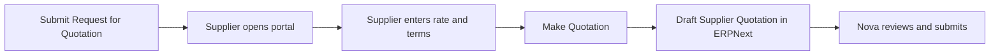

Imagine Nova Industries asks three suppliers to quote for a standard component. If every supplier replies by email, a buyer must copy rates, delivery dates, and terms into ERPNext. That adds work and creates opportunities for typing errors. The supplier portal lets each invited supplier enter its response directly against Nova's Request for Quotation.

The portal does not approve the supplier's offer automatically. It creates a draft [Supplier Quotation](/erpnext/supplier-quotation) for Nova's buying team to review, compare, and submit internally.

## Before you begin

Create the Supplier and a Contact with a valid email address. Link the Contact to the Supplier, create a Website User for the same email address, and assign only the portal access needed for the supplier relationship.

Prepare and submit the [Request for Quotation](/erpnext/request-for-quotation). Add the Supplier to the Suppliers table and make sure the relevant Contact and email are selected before sending the invitation.

## Invite the supplier

1. Open the submitted Request for Quotation.
2. Confirm the Supplier, Contact, email address, response deadline, Items, quantities, and UOMs.
3. Use the email action to send the RFQ link to the supplier.
4. Ask the supplier to sign in with the invited Website User.

Do not create a shared portal login for several suppliers. The Contact, Website User, and Supplier link determine which records the user can see.

## Enter the quotation in the supplier portal

The supplier opens the RFQ from the portal, reviews the requested Items, and enters the quoted rate, delivery date, and any available notes or terms. After checking the response, the supplier selects **Make Quotation**. ERPNext creates a draft Supplier Quotation linked to the RFQ and the invited Supplier.

## Review the result inside ERPNext

Nova's buyer opens the resulting draft Supplier Quotation and verifies the Supplier, currency, validity, quantities, UOMs, rates, taxes, delivery promise, and commercial terms.

The buyer can correct internal fields, request clarification, or reject the offer. Submit the Supplier Quotation only after it accurately represents the supplier's offer. A submitted quotation can then be compared with other responses and used to create a [Purchase Order](/erpnext/purchase-order).

## What the supplier can and cannot do

The supplier can see eligible portal RFQs linked to its Website User and enter its own quotation response. The supplier cannot approve Nova's Purchase Order, submit internal accounting documents, or see another supplier's response unless permissions are misconfigured.

Keep sensitive comparison, margin, approval, and internal-comment fields outside the portal experience.

## Troubleshooting

### The supplier cannot see the Request for Quotation

Confirm that the RFQ is submitted, the Supplier appears in the Suppliers table, the Contact is linked to that Supplier, and the Website User uses the same email address. Check that the response deadline has not passed and that portal permissions are not restricting the record.

### The supplier receives the email but cannot sign in

Verify that the Website User is enabled and that the invitation went to the same address. Reset the user's portal password or resend the login invitation without changing the Supplier relationship.

### Make Quotation does not create a record

Check that required rates, quantities, dates, and terms are complete. Confirm that the RFQ is still open for responses and that the portal user has permission to create a Supplier Quotation for the linked Supplier.

### The quotation appears under the wrong supplier

Review the Contact's Dynamic Links and the Website User's party association. Do not edit the quotation to hide an incorrect identity link; correct the portal relationship and recreate the response.

## Frequently asked questions

### Must every supplier use the portal?

The portal is optional. A buyer can create a Supplier Quotation from an emailed or offline response. The portal is useful when suppliers can enter their own structured response and you want to avoid retyping it.

### Is the portal quotation automatically submitted?

The portal quotation is not automatically submitted. It creates a draft for internal review. Nova's authorized user decides whether to submit it and use it for comparison or ordering.

### Can a supplier revise its response?

The exact behavior depends on the RFQ state and portal permissions. Use a controlled clarification or amendment process after the response becomes an internal Supplier Quotation so the audit trail remains clear.

### Can the supplier see competing quotations?

Correctly configured portal permissions restrict the user to its own Supplier relationship and eligible documents, so it cannot see competing quotations.

Prepare the relationship through [Supplier](/erpnext/supplier), [Contact](/erpnext/contact), and [Users and Permissions](/erpnext/users-and-permissions). The operational flow continues from [Material Request](/erpnext/material-request) to [Request for Quotation](/erpnext/request-for-quotation), [Supplier Quotation](/erpnext/supplier-quotation), and [Purchase Order](/erpnext/purchase-order). Use [Email Account](/erpnext/email-account) for outgoing mail, [Buying Settings](/erpnext/buying-settings) for purchasing controls, and [Supplier Scorecard](/erpnext/supplier-scorecard) for later performance review.

## Related topics

- [Supplier](/erpnext/supplier)
- [Contact](/erpnext/contact)
- [Request for Quotation](/erpnext/request-for-quotation)
- [Supplier Quotation](/erpnext/supplier-quotation)
- [Purchase Order](/erpnext/purchase-order)
- [Website Users](/erpnext/adding-users)