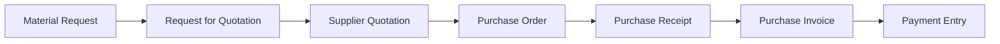
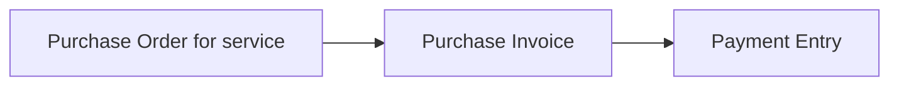
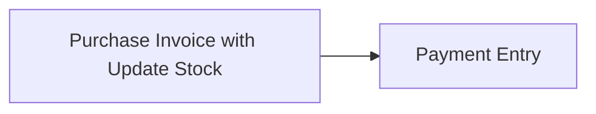

Imagine you have just joined Nova Industries as a buyer. Production asks for 200 adapters, a department needs a consulting service, and a warehouse manager wants an urgent replacement part. All three are purchases, but they do not need the same path.

The **procurement cycle** is the set of decisions and documents that takes Nova from a business need to an approved supplier commitment, receipt or service acceptance, supplier bill, and payment. ERPNext supports a full competitive cycle and shorter legitimate variants. The goal is not to create every document every time; it is to use the controls that fit the risk.

## Understand the standard cycle

| Document | Business meaning | Stock effect | General Ledger effect |
| --- | --- | --- | --- |
| Material Request | Internal requirement | None | None |
| Request for Quotation | Invitation to suppliers | None | None |
| Supplier Quotation | Supplier's offer | None | None |
| Purchase Order | Nova's commitment to buy | None | None |
| Purchase Receipt | Goods physically received | Updates stock | With perpetual inventory, posts interim stock accounting |
| Purchase Invoice | Supplier's bill | Only when Update Stock is enabled | Creates payable, expense or stock, and tax entries |
| Payment Entry | Money paid | None | Reduces payable and bank or cash |

## Choose the workflow

| Situation | Recommended flow | Why |
| --- | --- | --- |
| Planned stock purchase with competitive sourcing | Material Request → RFQ → Supplier Quotation → Purchase Order → Purchase Receipt → Purchase Invoice → Payment | Strong approval, comparison, receipt, and three-way matching trail |
| Repeat purchase from an approved supplier | Material Request or direct Purchase Order → Purchase Receipt → Purchase Invoice → Payment | Keeps internal need and commitment without repeating sourcing |
| Urgent low-risk purchase | Direct Purchase Order or direct Purchase Invoice, subject to policy | Fewer steps with controlled exception |
| Service purchase | Purchase Order → Purchase Invoice → Payment | No physical stock receipt is needed |
| Immediate stock purchase and bill | Purchase Invoice with Update Stock → Payment | One document records stock and payable; use only when separate receipt control is unnecessary |

### Planned goods purchase

Use the full cycle for production materials, important stock, new suppliers, or purchases that need comparison and formal approval. The Purchase Receipt confirms physical arrival; the Purchase Invoice confirms what the Supplier billed.

### Service purchase

Use a non-stock service Item. Record the expense account, Cost Center, Project, taxes, and acceptance evidence. A Purchase Receipt is normally unnecessary because no stock enters a warehouse.

### Direct purchase invoice with stock update

Use this for an immediate purchase where the bill and physical receipt occur together and your control policy allows one document. Do not also create a Purchase Receipt for the same goods.

## Configure the controls

[Buying Settings](/erpnext/buying-settings) can require Purchase Orders and Purchase Receipts, enforce rate consistency, control over-ordering or over-receipt, and define other buying behavior. Supplier-specific transaction controls can create approved exceptions without weakening the default for everyone.

Use Roles, User Permissions, Workflows, and Authorization Rules to separate request, approval, receiving, invoice verification, and payment duties.

## Follow one requirement through the cycle

Nova needs 200 adapters. The operations team raises a Material Request, the buyer invites suppliers, compares quotations, and places a Purchase Order with Keystone Cables. The warehouse accepts 195 units and isolates 5 damaged units. Finance records the supplier invoice for the accepted commercial quantity, and the payment team settles the payable.

Use the [Procurement Tracker](/erpnext/procurement-tracker-report) to monitor pending Material Requests and open Purchase Orders, including Supplier, cost, and delivery dates.

## What happens when downstream documents are created directly

A direct Purchase Order, Purchase Receipt, or Purchase Invoice can be valid when settings and policy allow it. However, skipped upstream documents do not gain ordered, received, or billed progress later. Reports and approvals that depend on explicit source references will show only the documents that actually exist.

Create downstream documents from their source whenever you need traceability and automatic quantity updates. Do not add references that did not represent the real process.

## Troubleshooting

### ERPNext requires a document that our process skips

Review Buying Settings and Supplier transaction controls. Configure a deliberate policy or Supplier exception instead of creating dummy documents.

### The Procurement Tracker has gaps

Confirm that downstream item rows carry their source references. A manually created document may be valid but will not automatically join an earlier requirement.

### Received and billed percentages do not match

This can be normal. Goods may arrive before the bill, services may be billed without receipt, or partial documents may cover different quantities. Open the linked receipts and invoices.

### The supplier was paid but the Purchase Order is still open

Order completion tracks receipt and billing, not payment. Review received and billed quantities on the order and outstanding amount on the invoice separately.

## Frequently asked questions

### Must every purchase start with a Material Request?

A Material Request is not mandatory for every purchase. Use it when an internal requirement and approval trail are useful. Direct orders or invoices can be appropriate for controlled exceptions.

### Must every goods purchase use both Purchase Receipt and Purchase Invoice?

Not always. Separate documents give stronger receiving and invoice-matching control. A Purchase Invoice with Update Stock combines both events when policy permits.

### Which document creates the supplier payable?

The Purchase Invoice. A Purchase Order is a commitment and a Purchase Receipt records stock.

### Which document should be used for partial deliveries?

Create separate Purchase Receipts for the quantities that arrive. ERPNext keeps the Purchase Order open for the balance.

Start with [Material Request](/erpnext/material-request) when an internal need must be recorded, use [Request for Quotation](/erpnext/request-for-quotation) and [Supplier Quotation](/erpnext/supplier-quotation) for competitive sourcing, and create a [Purchase Order](/erpnext/purchase-order) for the approved commitment. Record goods in [Purchase Receipt](/erpnext/purchase-receipt), the supplier liability in [Purchase Invoice](/erpnext/purchase-invoice), and settlement through [Payment Entry](/erpnext/payment-entry). Use [Buying Settings](/erpnext/buying-settings) for control rules, [Procurement Tracker](/erpnext/procurement-tracker-report) for active demand and orders, and [Buying Reports](/erpnext/buying_reports) for broader analysis.

## Related topics

- [Introduction to Buying](/erpnext/buying)
- [Buying Settings](/erpnext/buying-settings)
- [Material Request](/erpnext/material-request)
- [Request for Quotation](/erpnext/request-for-quotation)
- [Supplier Quotation](/erpnext/supplier-quotation)
- [Purchase Order](/erpnext/purchase-order)
- [Purchase Receipt](/erpnext/purchase-receipt)
- [Purchase Invoice](/erpnext/purchase-invoice)
- [Payment Entry](/erpnext/payment-entry)
- [Procurement Tracker](/erpnext/procurement-tracker-report)
