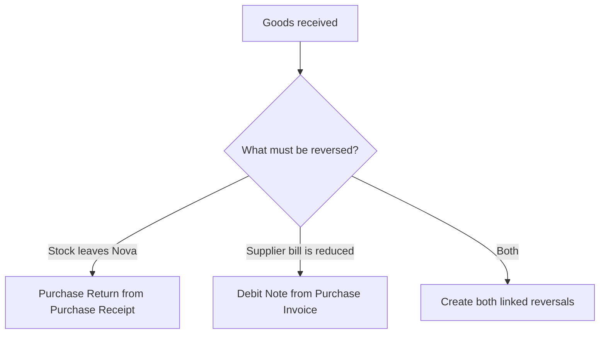

Imagine Nova Industries receives 200 adapters from Keystone Cables. Five fail inspection and are kept in the Returns Warehouse. Recording the rejection is not enough if Nova sends those units back: stock must leave the warehouse, the original receipt must show the returned quantity, and any supplier bill may also need a credit adjustment.

A **Purchase Return** reverses the physical receipt. Create it from the original submitted [Purchase Receipt](/erpnext/purchase-receipt) so ERPNext uses negative quantities, preserves the source reference, and values the return at the original receipt rate. If the supplier has already billed Nova, also create a **Debit Note** from the [Purchase Invoice](/erpnext/purchase-invoice) to reverse the accounting amount.

## Before you begin

Use the original submitted Purchase Receipt. Confirm which warehouse holds the goods, whether the Items are serial or batch controlled, and whether a Purchase Invoice has already been submitted.

Agree the return quantity and commercial treatment with the Supplier. A physical return and an accounting credit solve different parts of the same event.

## Return stock to the supplier

1. Open the original submitted Purchase Receipt.
2. Select **Create &gt; Purchase Return**.
3. Confirm that **Is Return** is enabled and **Return Against** points to the original receipt.
4. Remove Items that are not being returned.
5. Enter the quantity being returned. ERPNext shows return quantities and amounts as negative values.
6. Select the warehouse from which the goods will leave.
7. Check serial numbers, batches, taxes, and valuation.
8. Save and submit the return.

For Nova's five damaged adapters, the return should remove five units from **Returns Warehouse**, not from Receiving Warehouse. Use **Return Qty from Rejected Warehouse** or select the rejected warehouse in the item row when the original rejected quantity is the source.

## Verify the stock result

After submission, open **View &gt; Stock Ledger**. The return should show a negative stock movement from the selected warehouse at the original receipt valuation rate.

The original Purchase Receipt and linked Purchase Order update their returned quantities. If every received Item is returned, the original receipt can show **Return Issued**. A fully billed receipt may continue to show **Completed**, so review the Connections and returned quantities rather than relying on one status alone.

## Reverse the supplier bill with a Debit Note

If Nova has already recorded the supplier's invoice, open the submitted Purchase Invoice and select **Create &gt; Return / Debit Note**. ERPNext creates a return Purchase Invoice with negative quantities and amounts.

Submit the Debit Note after checking the Supplier, original invoice, expense or stock accounts, taxes, and payable effect. It reduces the supplier balance or creates credit that can be allocated against another invoice or payment.

A Debit Note updates stock only when **Update Stock** is enabled. When stock was received through a separate Purchase Receipt, keep the physical reversal in the Purchase Return and use the Debit Note for accounting. This avoids reversing the same stock twice.

## Understand the ledger impact

| Action                                | Stock Ledger                            | General Ledger                                                                             |
| ------------------------------------- | --------------------------------------- | ------------------------------------------------------------------------------------------ |
| Purchase Return from Purchase Receipt | Reduces the selected warehouse quantity | With perpetual inventory, credits Stock In Hand and debits Stock Received But Not Billed   |
| Debit Note without Update Stock       | No stock change                         | Reverses the payable and purchase-side accounting of the original invoice                  |
| Debit Note with Update Stock          | Reduces stock                           | Reverses both stock and invoice accounting; use only when the invoice itself created stock |

## Handle partial returns

Return only the affected Items and quantities. The remainder stays received and can be billed normally. Several returns can reference the same receipt as long as the cumulative returned quantity does not exceed the eligible received quantity.

For serialized or batch-controlled Items, select the exact identifiers being returned. ERPNext must be able to trace them to the warehouse and source receipt.

## Troubleshooting

### The return quantity exceeds the received quantity

Check earlier returns, the selected source receipt, UOM conversion, and item-row quantity. ERPNext prevents the cumulative return from exceeding what is eligible.

### ERPNext says the serial number is not in the warehouse

Review the serial number's current warehouse and movement history. Return it from the warehouse where it is actually held and confirm that it belongs to the source receipt.

### The supplier balance did not change

A Purchase Return reverses stock, not the supplier invoice. Create and submit a Debit Note against the billed Purchase Invoice, then allocate the credit as required.

### Stock was reduced twice

Check whether both the Purchase Return and the Debit Note updated stock. When the original flow used a separate Purchase Receipt, the Debit Note normally should not have **Update Stock** enabled.

### The original receipt status did not become Return Issued

Confirm whether every eligible quantity was returned and whether the receipt was already fully billed. Review the returned quantity and Connections for the authoritative result.

## Frequently asked questions

### Is a Purchase Return the same as a Debit Note?

A Purchase Return and a Debit Note reverse different effects. A Purchase Return reverses the stock receipt. A Debit Note reverses the supplier bill. A transaction that affects both stock and the payable may require both documents.

### Can I create a return without the original Purchase Receipt?

Use the original source whenever possible because it preserves valuation and prevents excess return. A manually created return requires more care and may not update the intended source document.

### Which rate does ERPNext use for returned stock?

The return is valued against the original receipt so the stock reversal matches the incoming value rather than today's purchase price.

### Can rejected Items remain in Nova instead of being returned?

Rejected Items can remain in Nova temporarily. Keep them in the rejected warehouse while the Supplier decides whether to replace, credit, repair, or collect them. Create the return only when the stock actually leaves Nova.

Start from the original [Purchase Receipt](/erpnext/purchase-receipt) or [Purchase Invoice](/erpnext/purchase-invoice), and use a [Debit Note](/erpnext/debit-note) when the supplier liability must be reduced. Verify stock through [Stock Ledger](/erpnext/stock-ledger), serial or batch traceability through [Serial Number](/erpnext/serial-no) and [Batch](/erpnext/batch), and payment adjustment through [Payment Entry](/erpnext/payment-entry). Review the source [Purchase Order](/erpnext/purchase-order), [Accounts Payable](/erpnext/accounts-receivable-and-payable), [Buying Settings](/erpnext/buying-settings), and [Supplier](/erpnext/supplier) record when the return does not affect the expected balances.

## Related topics

- [Purchase Receipt](/erpnext/purchase-receipt)
- [Purchase Invoice](/erpnext/purchase-invoice)
- [Debit Note](/erpnext/debit-note)
- [Purchase Order](/erpnext/purchase-order)
- [Stock Ledger](/erpnext/stock-ledger)
- [Serial Number](/erpnext/serial-no)
- [Batch](/erpnext/batch)