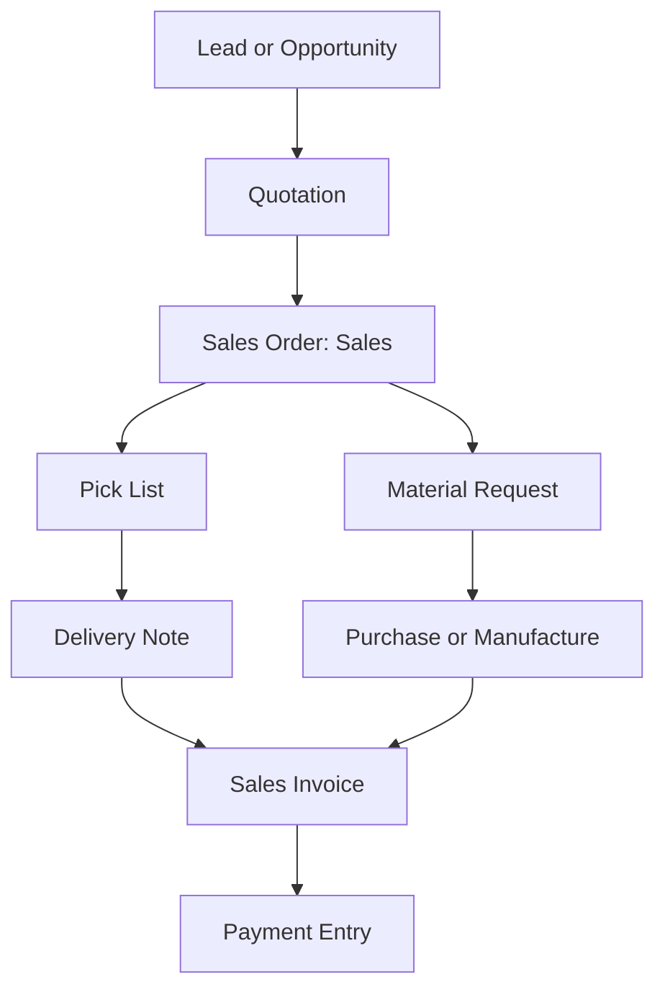
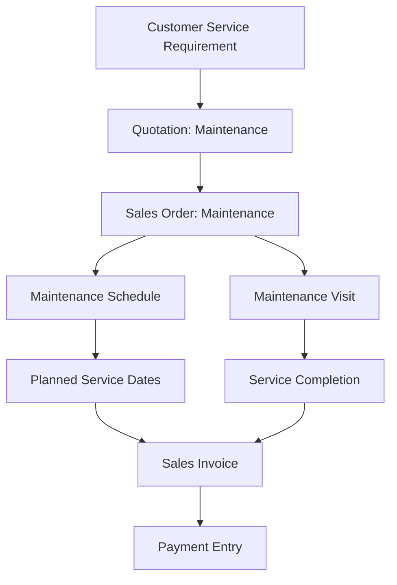
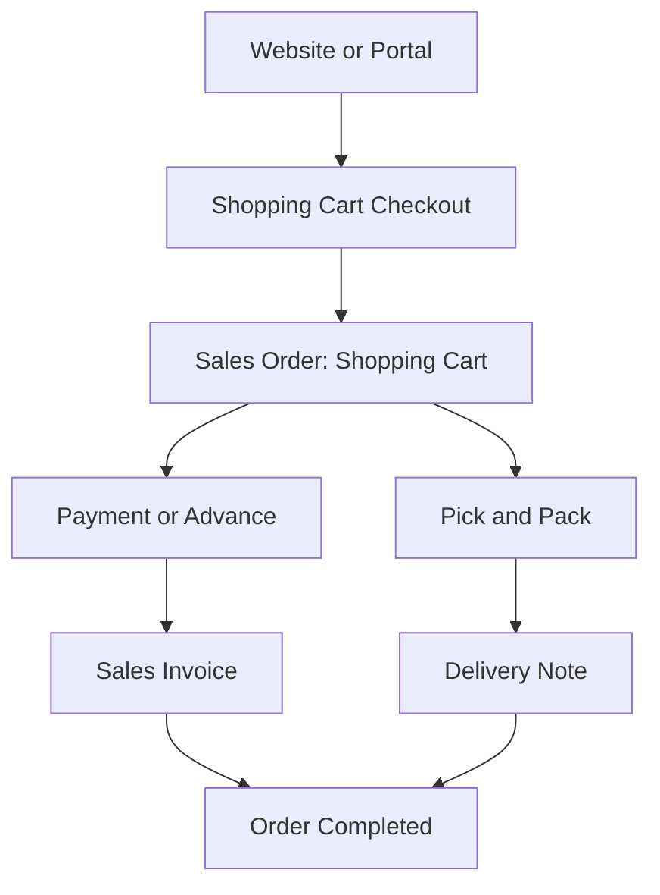

A Sales Order is the customer-confirmed commitment to sell goods or services. In ERPNext, the Order Type helps the system understand what kind of sales cycle should follow after the order is submitted.

ERPNext includes three standard Sales Order types:

- Sales
- Maintenance
- Shopping Cart

Each type uses the same Sales Order document, but the downstream cycle is slightly different.

## 1. Sales Order Type: Sales

Use Sales when the customer is buying goods or services through the regular sales process. This is the most common order type.

A Sales order usually starts after a customer accepts a quotation, or when the sales team directly records a confirmed customer order.

Typical examples:

- Selling stock items to a customer
- Selling finished goods
- Selling services that need billing
- Selling products that need delivery before invoicing

### Typical Sales Cycle

The exact path depends on how the company operates. If the item is in stock, the team may create a Pick List and Delivery Note. If the item needs to be purchased or manufactured, the Sales Order can help create a Material Request, Purchase Order, Work Order, or Production Plan.

A Sales Invoice can be created after delivery, before delivery, or independently, depending on company policy and configuration.

### When to use it

Use Sales when the order will normally result in delivery, billing, or both.

## 2. Sales Order Type: Maintenance

Use Maintenance when the customer order is for after-sales service, repair, annual maintenance, support visits, or scheduled maintenance.

This order type is useful when the main activity is not simply shipping goods, but performing service work for a customer.

Typical examples:

- Annual maintenance contracts
- Equipment repair visits
- Preventive maintenance
- Customer support visits
- Service work linked to installed products

### Typical Maintenance Cycle

A Maintenance Schedule is used when service needs to happen on planned dates. A Maintenance Visit is used to record the actual work done. The order can still be billed through a Sales Invoice.

### When to use it

Use Maintenance when the customer is buying service work that must be scheduled, visited, tracked, or completed over time.

## 3. Sales Order Type: Shopping Cart

Use Shopping Cart when the Sales Order is created from an e-commerce or website checkout flow.

This order type is still a Sales Order, but it usually starts from the customer placing an online order instead of the internal sales team creating the order manually.

Typical examples:

- Website orders
- E-commerce checkout
- Customer self-service orders
- Online orders using coupons or loyalty points

### Typical Shopping Cart Cycle

Shopping Cart orders may include website-specific information such as loyalty points, coupons, shipping charges, or online payment information. After the order is submitted, the fulfillment and billing steps are similar to a regular Sales order.

### When to use it

Use Shopping Cart when the order originates from the website or e-commerce flow.

## Quick Comparison

| Order Type    | Best For                                   | Common Next Documents                                                                  |
| ------------- | ------------------------------------------ | -------------------------------------------------------------------------------------- |
| Sales         | Regular sale of goods or services          | Pick List, Delivery Note, Sales Invoice, Material Request, Work Order, Production Plan |
| Maintenance   | Service, repair, support, scheduled visits | Maintenance Schedule, Maintenance Visit, Sales Invoice                                 |
| Shopping Cart | Website or e-commerce orders               | Sales Invoice, Delivery Note, Payment Entry                                            |

## How to choose the right Sales Order type

Choose Sales when the order is part of the normal selling and fulfillment process.

Choose Maintenance when the customer has ordered service work that needs scheduling, visits, or completion tracking.

Choose Shopping Cart when the order came from the website or customer portal checkout.

In all cases, the Sales Order remains the central document that confirms what the customer ordered, at what price, and under what terms. The Order Type simply helps guide the next steps in the sales cycle.