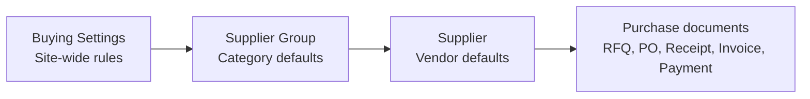

Before the first Purchase Order goes out, a company has to tell ERPNext who it buys from and on what terms. At Nova Electronics Trading (NET), Nova Industries' distribution company, that means three phone, laptop and tablet makers, a new accessories supplier called Keystone Cables, and one rule that all of them are paid 30 days after invoicing.

Put those terms in the wrong place and they either have to be typed on every supplier or are silently missing on the one supplier where they matter. This page shows which supplier records exist, what each one controls, and in which order to set them up, so that each default is entered once at the right level.

## The records and how defaults flow

Three records shape every purchase document:

| Record | What it holds | Set up |
| --- | --- | --- |
| [Buying Settings](/erpnext/buying-settings) | Company-wide rules: how suppliers are named, the default buying price list, which documents must come first, the same-rate check across the purchase cycle. | Once, before the first supplier. |
| [Supplier Group](/erpnext/supplier-group) | A category of suppliers with default payment terms and payable accounts per company. | Once per category. |
| [Supplier](/erpnext/supplier) | One vendor: its currency, price list, payment terms, addresses, contacts, accounts, tax details and holds. | For every vendor. |

When a document needs a value, ERPNext takes the most specific one available. The supplier's own value wins, then its group's, then the company or Buying Settings default.

NET's Keystone Cables shows the chain at work. Its group, Nova Electronics Suppliers, carries Net 30; the supplier itself sets the Nova Purchase USD price list in place of Buying Settings' Standard Buying. Its first order, PUR-ORD-2026-00022 for 200 USB-C adapters at $18.00, opened with both already filled in.

None of these records posts anything to the books. Accounting and stock effects start with the purchase documents: a Purchase Order is a commitment with no ledger entry, a Purchase Receipt adds stock, and a Purchase Invoice records what you owe the supplier. [Purchase Cycle Ledger Impact](/erpnext/purchase-cycle-ledger-impact) shows the entries each one creates.

## Set up suppliers in this order

1. Review [Buying Settings](/erpnext/buying-settings), especially **Supplier Naming By**, because the rule applies only to suppliers created after it is set.
2. Create the buying [Price Lists](/erpnext/price-lists) and [Payment Terms Templates](/erpnext/payment-terms-template) your suppliers will use.
3. Create a [Supplier Group](/erpnext/supplier-group) for each category that shares terms or accounts, and set those defaults on the group.
4. Create each [Supplier](/erpnext/supplier) in its group, then add its address and contact.

## Choose the setup for the kind of supplier

| Kind of supplier | What to set | Where to read more |
| --- | --- | --- |
| A domestic vendor on standard terms | Group defaults only; the supplier inherits them. | [Supplier Group](/erpnext/supplier-group) |
| A vendor billing in another currency | **Billing Currency** and a price list in that currency on the supplier. | [Multi Currency Accounting](/erpnext/multi-currency-accounting) |
| One of your own companies | **Is Internal Supplier** and **Represents Company** on the supplier. | [Inter Company Invoices](/erpnext/inter-company-invoices) |
| A vendor whose taxes differ from the rest | A **Tax Category** on the supplier, matched by Tax Rules. | [Tax Category](/erpnext/tax-category) |
| A vendor who quotes through your website | **Portal Users** on the supplier. | [Supplier Quotation through the Supplier Portal](/erpnext/how-to-create-a-supplier-quotation-through-the-supplier-portal) |
| A vendor you need to monitor or pause | A [Supplier Scorecard](/erpnext/supplier-scorecard), or **Block Supplier** on the supplier. | [Supplier](/erpnext/supplier) |

## Next steps

With suppliers in place, ask them for prices with a [Request for Quotation](/erpnext/request-for-quotation) or go straight to a [Purchase Order](/erpnext/purchase-order). To record the part numbers your suppliers use for your items, see [Maintaining Supplier's Item Code in the Item Master](/erpnext/maintaining-suppliers-part-no-in-item).

## Related topics

- [Supplier Group](/erpnext/supplier-group)
- [Supplier](/erpnext/supplier)
- [Buying Settings](/erpnext/buying-settings)
- [Supplier Scorecard](/erpnext/supplier-scorecard)
- [Request for Quotation](/erpnext/request-for-quotation)
- [Purchase Order](/erpnext/purchase-order)
